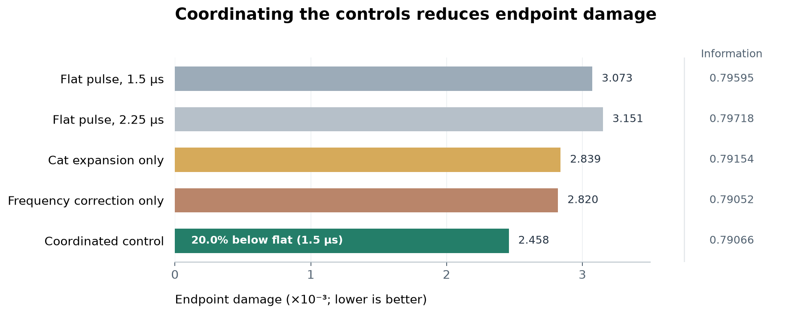
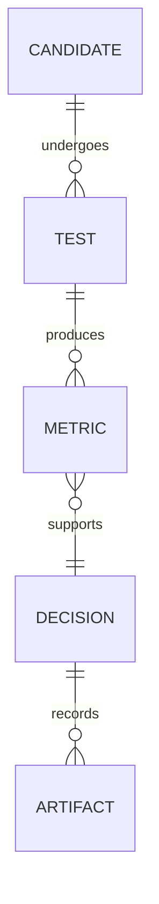

# Cat Qubits: From Losing Photons to Reading a Bit

Our Alice & Bob DuQuantum 2026 project starts with photon loss and ends with a
question about measurement: **Can the buffer's natural ringing help us read a cat qubit?**

We built the introductory-track foundations, characterized logical errors, and
developed a standard-track extension that coordinates temporary cat expansion,
microwave phases, and the receiver. In a nonlinear stress model, the combined
control reduces endpoint damage by about **20%** relative to a closely matched
flat pulse. A separate noisy-record audit measures its assignment error and
tests whether protection survives measurement.

The result is a tested control proposal, an executed [Jupyter notebook](cat_qubits.ipynb),
and a numerical record of what worked, what failed, and why.

## The Creative Step: Let the Cat Qubit have some Room, Then Follow Its Frequency

Our memory oscillator stores the logical states near opposite coherent states.
A lossy buffer both stabilizes the memory and carries the readout signal.
Increasing the cat's separation can help distinguish the states, but it also
changes the buffer's occupation-dependent frequency shift.

Our strategy coordinates three operations:

1. Briefly expand the cat through the buffer stabilization drive.
2. Compensate for the estimated cross-Kerr shift with synchronized drive and pump phases.
3. Apply a matched filter to the buffer waveform, with the homodyne reference following the phase.

For the final pulse,

$$
\epsilon_B(t)=g_2\alpha^2[1+0.45r(t)],
\qquad
\delta_b(t)=-\chi\alpha^2[1+0.45r(t)].
$$

Here, $r(t)=\sin^2(\pi t/T)$ during the $T=1.5\,\mu s$ pulse and is zero
outside it. The static correction remains during recovery. Opposing pump and
buffer-drive chirps implement the effective detuning within our rotating-wave
model; the receiver follows the same frame.

The combined pulse has lower endpoint damage than either expansion alone or
frequency correction alone. The [phase derivation](REPORT.md#readout-phase-recipe)
and [matrix audit](artifacts/pump_detuning_phase_audit.json) check the prescription
and signs. Hardware bandwidth and calibration remain to be tested.
The buffer can ring; the receiver needs to know the tune.

## Results, With the Evidence

The final stress model uses $\alpha=2.1$, cross-Kerr $\chi/2\pi=0.30$ MHz,
buffer Kerr $K_b/2\pi=3.3$ MHz, and memory dephasing of $1$ kHz.

| Question | Result | Evidence |
| --- | --- | --- |
| Does coordinating the controls reduce damage? | $0.003073$ to $0.002458$: **20.0% lower** than flat readout | [Comparison and ablations](artifacts/pump_detuning_strong_comparison.csv) |
| Is comparable signal information retained? | Joint $0.79066$ versus flat $0.79595$, at the same $3\,\mu s$ endpoint | [Comparison](artifacts/pump_detuning_strong_comparison.csv) |
| Can the final receiver assign the initial bit? | **14 errors / 1,024 records** after $21\,\mu s$: 1.37% error, 95% Wilson interval 0.82–2.28% | [Receiver results](artifacts/final_validation_receiver.csv) |
| Is accuracy better than flat readout? | Flat gives 9 / 1,024 errors; an accuracy improvement is not demonstrated | [Paired comparison](artifacts/final_validation_accuracy_comparison.csv) |
| Is idle protection preserved? | **No:** total contrast decay is 1.67 times matched idle, exceeding our 1.10 audit limit | [Preservation test](artifacts/final_validation_idle_test.csv) |



Damage counts wrong-codeword population plus leakage, taking the worse input.
The comparisons share a memory-drive cap and observation time; the joint pulse
spends extra buffer amplitude and phase control. Information is closely matched.

The low assignment error takes seven cycles without resets and assumes ideal
detection. At $3\,\mu s$, the joint receiver still makes 209 / 1,024 errors
(20.41%). Its threshold and template are fixed from deterministic signals;
classification uses only the buffer record.

## From the Introductory Tasks to the Full Model

We used Python, Dynamiqs, JAX, and QuTiP to connect analytic checks, density-matrix
evolution, Wigner functions, and stochastic measurement records. The foundation is

$$
H_{2\mathrm{ph}}=g_2(a^2b^\dagger+a^{\dagger2}b)-\epsilon_B(b+b^\dagger),
\qquad
\dot\rho=-i[H,\rho]+\sum_j\mathcal D[L_j]\rho.
$$

Here, $a$ is the memory mode and $b$ the buffer. The loss operators are
$\sqrt{\kappa_a}a$ and $\sqrt{\kappa_b}b$; the stress model adds memory dephasing
and nonlinear Hamiltonian terms. Time is in microseconds; angular rates include $2\pi$.

| Task | What We Established | Evidence |
| --- | --- | --- |
| 1.0(a): Single-photon loss | Analytic agreement within $1.99\times10^{-11}$ photons | [Loss curve](artifacts/01_single_photon_loss.png) |
| 1.0(b): Pair loss | Final population $0.499832269$, matching initial odd parity | [Parity check](artifacts/03_pair_loss.png) |
| 1.0(c): Stabilization | Sweep at $\kappa_2/4$, $\kappa_2$, and $4\kappa_2$, with Wigner snapshots | [Sweep](artifacts/04_effective_stabilization.png), [Wigner plots](artifacts/05_effective_cat.png) |
| 1.1–1.2: Full inflation and convergence | Independent cutoffs, transient peaks, and tails; population $4.40196$ versus target $\alpha^2=4.41$ | [Transients](artifacts/06_full_inflation_and_tails.png), [Cutoffs](artifacts/cutoff_convergence.csv) |
| 1.3(a): Identify the state | Parity, purity, fidelity, and interference identify an even cat; best fidelity $0.8443$ | [Diagnostics](artifacts/08_which_cat.png) |
| 1.3(b–c): Logical preparation | Seeded positive-codeword fidelity $0.99878$, with calibration and control costs discussed | [Sweep](artifacts/logical_state_preparation.csv), [Explanation](REPORT.md#logical-state-preparation) |
| 2.1–2.2: Errors | Bit-decay exponent $2.9545$ over the tested small-cat range; phase-decay slope $0.116684$ versus predicted $0.116867$ | [Bit rates](artifacts/bit_flip_rates.csv), [Phase rates](artifacts/phase_flip_rates.csv) |
| 2.3: Buffer readout | Opposite signals, weak-drive contrast $-0.047576$, and 2% settling by $0.815\,\mu s$ | [Readout](artifacts/12_buffer_readout.png) |
| 2.4(a): Controls | Circuit-drive derivation and synchronized phase prescription | [Derivations](REPORT.md#circuit-drive) |
| 2.4(b–d): Improved readout | Tradeoffs, receiver comparisons, ablations, and final audits; capstone protection remains unmet | [Controls](artifacts/method_control_comparison.csv), [Audit](artifacts/final_validation_summary.json) |

## How the Design Evolved

Flat pulses established the baseline. Resonant and closed pulses made the buffer
transient useful, while matched filtering avoided cancelling its changing-sign
signal through plain averaging. Robust pulses, recovery lobes, and derivative
corrections gave us alternatives to test.

Temporary expansion helped more in the ideal model than under nonlinear stress.
That gap led to frequency tracking and tests of each control separately.
Our contribution is the coordinated strategy and its validation.



The [decision schema](REPORT.md#decision-schema) and [failed-method log](fails.md)
preserve the reasoning behind those choices.

## Checks, Lessons, and the Remaining Gap

We checked deterministic results at $32\times8$ and $36\times10$, tightened
tolerances, and varied fit windows. The independent chirped-frame check agrees
within $4.48\times10^{-9}$ in density-matrix norm. The final audit reproduces
the earlier first-cycle information and damage.

An ensemble check caught artificial heating in an initial stochastic scheme,
despite normalized states. We rejected those scores and corrected the numerical
map. The accepted ensembles pass the photon-number check against the master
equation. A normalized cat can still be a numerically suspicious cat.

The larger-cutoff joint receiver sample supports our equivalence margin; the
smaller-time-step sample leaves it statistically unresolved. Idle preservation
fails after numerical checks and a diagnostic separating leakage from logical
contrast decay. These finite-cycle rates differ from Task 2.1's stationary rates.

Our strongest result is a lower-damage strategy with an explicit phase
prescription and low observed long-record error. The next search should optimize
total active decay relative to idle alongside assignment error. The full
standard capstone target remains unmet.

## Reproduce the Results

```sh
python3 -m venv .venv
.venv/bin/python -m pip install -r requirements.txt
```

Open [cat_qubits.ipynb](cat_qubits.ipynb) in that environment. All **105 cells**
executed in a fresh pinned environment with the supplied artifacts; default
execution reloads some expensive saved comparisons. The
[run record](artifacts/clean_environment_validation.json) captures versions and
source hashes; the [data check](artifacts/final_validation_data_checks.json)
independently verifies saved counts and confidence intervals.

The last four cells work after a kernel restart.
`final_validation_recompute = False` loads the audit; `True` recomputes it using
compatible checkpoints. [REPORT.md](REPORT.md) contains full derivations,
earlier calibrations, and the development history.

## AI ACKNOWLEDGEMENT
AI was used in preperation of literature review, cited in the notebook, generating the presentation as well as code debugging and help bouncing off of ideas, It was also used to help create testing files. AI was also used for cleaning and rewording the report!! 
