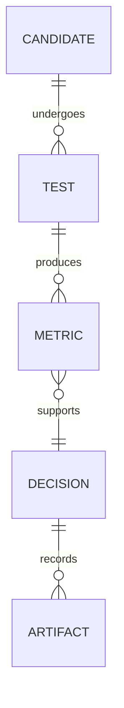

# cat qubits, from losing photons to reading a bit

our Alice & Bob DuQuantum 2026 submission covers the introductory track and
extends into the standard track. the question that kept us going: can the
buffer's natural ringing help us read the cat?

we built and checked the cat first, then tested readout pulses and receivers.
our final proposal briefly expands the cat and tracks the buffer's cross-Kerr
shift with coordinated pump, drive, and receiver phases.

open [the notebook](cat_qubits.ipynb) for code and outputs.
[the detailed report](REPORT.md) has every task, derivation, figure, and decision.

## the main result

| experiment | result | evidence |
| --- | --- | --- |
| endpoint test, $\chi/2\pi=0.30$ MHz | information $0.79066$; damage $0.002458$, about 20.0% below the closely matched flat baseline | [comparison](artifacts/pump_detuning_strong_comparison.csv) |
| separate six-cycle test, $\chi/2\pi=0.15$ MHz | extra readout decay falls from $3.0550\times10^{-4}$ to $3.3566\times10^{-5}$ per $\mu s$: an 89.0% reduction | [rates](artifacts/pump_detuning_nonlinear_cycles_32_8.csv), [settings](artifacts/pump_detuning_cycle_settings.json) |

these tests use different calibrations. endpoint damage counts wrong-codeword
population plus leakage, taking the worse of the two inputs after $3\,\mu s$.
the cycle result subtracts each protocol's corresponding idle decay.


## both tracks, checked

| task | what we did and found | evidence |
| --- | --- | --- |
| 1.0(a) | single-photon loss agrees with the analytic curve to $1.99\times10^{-11}$ photons | [figure 1](artifacts/01_single_photon_loss.png) |
| 1.0(b) | pair loss leaves $0.499832269$ photons, matching the initial odd-parity probability | [figure 3](artifacts/03_pair_loss.png) |
| 1.0(c) | effective stabilization from vacuum, with $\kappa_2/4$, $\kappa_2$, and $4\kappa_2$, plus Wigner snapshots | [sweep](artifacts/04_effective_stabilization.png), [Wigner plots](artifacts/05_effective_cat.png) |
| 1.1–1.2 | full two-mode inflation, both truncation sweeps, transient peaks, and tails; final memory population $4.40196$ versus target $4.41$ | [transients](artifacts/06_full_inflation_and_tails.png), [cutoffs](artifacts/cutoff_convergence.csv) |
| 1.3(a) | parity, fidelity, purity, and interference distinguish the even cat from a mixture; best even-cat fidelity $0.8443$ | [figure 8](artifacts/08_which_cat.png) |
| 1.3(b–c) | a coherent seed selects the positive codeword with fidelity $0.99878$; we discuss displacement calibration and control-port costs | [seed sweep](artifacts/logical_state_preparation.csv), [discussion](REPORT.md#logical-state-preparation) |
| 2.1–2.2 | bit-decay exponent $2.9545$ over the tested small-cat range; phase-decay slope $0.116684$ versus predicted $0.116867$ | [bit rates](artifacts/bit_flip_rates.csv), [phase rates](artifacts/phase_flip_rates.csv) |
| 2.3 | opposite buffer signals; weak-drive contrast $-0.047576$, with 2% settling by $0.815\,\mu s$ | [figure 12](artifacts/12_buffer_readout.png) |
| 2.4(a) | derive memory-drive routes, resonant circuit corrections, and the final chirp prescription | [derivations](REPORT.md#circuit-drive) |
| 2.4(b–d) | sweep the contrast/error tradeoff, compare controls, and test the final proposal; preservation of idle bit protection remains open | [DC tradeoff](artifacts/dc_readout_tradeoff.csv), [control comparison](artifacts/method_control_comparison.csv) |

## why we chose this direction

flat pulses gave us a baseline. resonant and closed pulses used the buffer
transient, but plain averaging cancelled parts of the changing-sign signal.
a matched filter could actually listen to that waveform.

temporary cat expansion helped in the ideal model, then lost much of its
advantage under nonlinear stress. that led us to compensate the buffer's
occupation-dependent frequency shift too. the joint pulse beats both
single-control ablations in the strong-cross-Kerr endpoint comparison.

for the strong-cross-Kerr endpoint test, the selected waveform is

$$
\epsilon_B(t)=g_2\alpha^2[1+0.45r(t)],
\qquad
\delta_b(t)=-\chi\alpha^2[1+0.45r(t)],
$$

where $r(t)=\sin^2(\pi t/T)$ for $0\le t<T$, with $T=1.5\,\mu s$, and zero afterward.
the static detuning remains during recovery. opposite pump and buffer-drive
chirps produce this effective term; the homodyne reference follows the buffer
phase. [the frame derivation](REPORT.md#readout-phase-recipe)
and [numerical audit](artifacts/pump_detuning_phase_audit.json) check the signs
and measured quadrature.

our decision trail, in miniature:



the [full decision schema](REPORT.md#decision-schema)
and [failed-method log](fails.md) include robust pulses, recovery lobes,
derivative corrections, and receiver alternatives.

## what we checked, and what remains open

we varied memory and buffer cutoffs separately, checked transient tails, and
compared slow decay fits with generator eigenvalues. final endpoint results
agree closely at $32\times8$ and $36\times10$. a separate small-matrix check
finds the chirped and effective descriptions agree within $4.48\times10^{-9}$
in density-matrix norm.

the comparisons share a memory-drive cap and observation time, but the joint
pulse spends extra buffer-drive amplitude and phase control. the flat endpoint
baselines have about 0.7–0.8% more information than the joint pulse.

the earlier ideal-model breathing receiver gave 162 errors versus 182 on 1024
paired records; its 95% difference interval is $[-5.4,+1.5]$ percentage points.
the improvement is unresolved. final-pulse assignment fidelity, hardware
response, and preservation of the idle bit-decay rate remain to be demonstrated.

## run it

```sh
python3 -m venv .venv
.venv/bin/python -m pip install -r requirements.txt
```

select that environment and open [cat_qubits.ipynb](cat_qubits.ipynb).
run the foundational cells in order to recompute the introductory tasks, rates,
and original readout comparisons. time is in microseconds; rates include $2\pi$.

for a quick inspection after restarting the kernel, the addendum loads saved
results with `audit_load_saved = True`. the final cross-Kerr section also loads
its tables directly, and its last phase-audit cell runs independently.
`detuning_recompute = True` reruns the final endpoint comparison after the model
setup; it does not regenerate every saved exploratory or cycle table.

the notebook is the main deliverable. [REPORT.md](REPORT.md) contains the full
math and development history; [artifacts/](artifacts/) holds the numerical
evidence. the cat can meow; the receiver still has to listen in the right key.
