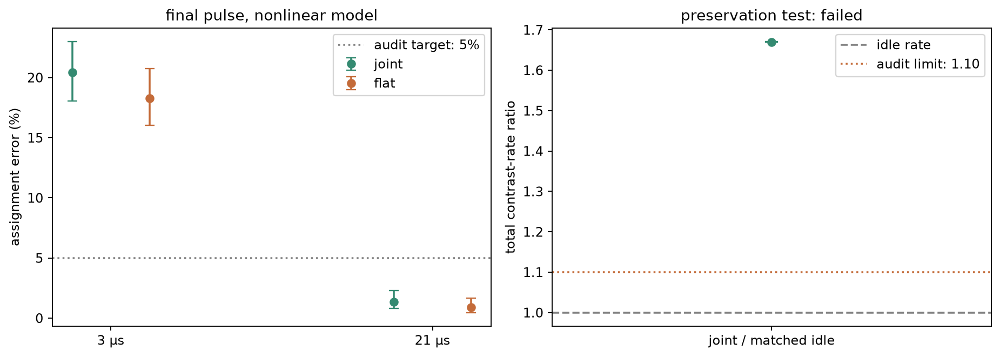
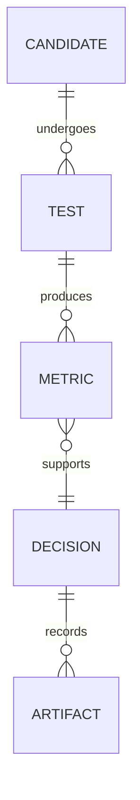

# cat qubits, from losing photons to reading a bit

our Alice & Bob DuQuantum 2026 submission covers the introductory track and
extends into the standard track. the question that kept us going: can the
buffer's natural ringing help us read the cat?

our final proposal briefly expands the cat and tracks the buffer's cross-Kerr
shift with coordinated pump, drive, and receiver phases.

open [the notebook](cat_qubits.ipynb) for code and outputs.
[the detailed report](REPORT.md) has every task, derivation, figure, and decision.

## the main result

| experiment | result | evidence |
| --- | --- | --- |
| endpoint test, $\chi/2\pi=0.30$ MHz | information $0.79066$; damage $0.002458$, about 20.0% below the closely matched flat baseline | [comparison](artifacts/pump_detuning_strong_comparison.csv) |
| final-pulse readout, same nonlinear model | 14 errors / 1024 records after $21\,\mu s$: **1.37% error**, 95% Wilson interval 0.82–2.28% | [records](artifacts/final_validation_receiver.csv), [audit](artifacts/final_validation_findings.md) |
| accuracy versus matched flat readout | flat gives 9 / 1024 errors; the joint pulse has not demonstrated better accuracy | [comparison](artifacts/final_validation_accuracy_comparison.csv) |
| preservation of idle protection | **fails** our 10% tolerance: total active contrast decay is about 1.67 times matched idle | [rates](artifacts/final_validation_protection.csv), [test](artifacts/final_validation_idle_test.csv) |

endpoint damage counts wrong-codeword population plus leakage after $3\,\mu s$,
taking the worse input. low assignment error takes seven cycles without resets;
at $3\,\mu s$ the joint receiver still makes 209 / 1024 errors (20.41%). less
damage alone does not establish better readout or preserved idle protection.



## both tracks, checked

| task | what we did and found | evidence |
| --- | --- | --- |
| 1.0(a) | single-photon loss agrees with the analytic curve to $1.99\times10^{-11}$ photons | [figure 1](artifacts/01_single_photon_loss.png) |
| 1.0(b) | pair loss leaves $0.499832269$ photons, matching the initial odd-parity probability | [figure 3](artifacts/03_pair_loss.png) |
| 1.0(c) | effective stabilization from vacuum, with $\kappa_2/4$, $\kappa_2$, and $4\kappa_2$, plus Wigner snapshots | [sweep](artifacts/04_effective_stabilization.png), [Wigner plots](artifacts/05_effective_cat.png) |
| 1.1–1.2 | full two-mode inflation, both truncation sweeps, transient peaks, and tails; final memory population $4.40196$ versus target $4.41$ | [transients](artifacts/06_full_inflation_and_tails.png), [cutoffs](artifacts/cutoff_convergence.csv) |
| 1.3(a) | parity, fidelity, purity, and interference distinguish the even cat from a mixture; best even-cat fidelity $0.8443$ | [figure 8](artifacts/08_which_cat.png) |
| 1.3(b–c) | a coherent seed selects the positive codeword with fidelity $0.99878$; we discuss displacement calibration and control-port costs | [seed sweep](artifacts/logical_state_preparation.csv), [discussion](REPORT.md#logical-state-preparation) |
| 2.1–2.2 | bit-decay exponent $2.9545$ over the tested small-cat range; phase-decay slope $0.116684$ versus predicted $0.116867$ | [bit rates](artifacts/bit_flip_rates.csv), [phase rates](artifacts/phase_flip_rates.csv) |
| 2.3 | opposite buffer signals; weak-drive contrast $-0.047576$, with 2% settling by $0.815\,\mu s$ | [figure 12](artifacts/12_buffer_readout.png) |
| 2.4(a) | derive memory-drive routes, resonant circuit corrections, and the final chirp prescription | [derivations](REPORT.md#circuit-drive) |
| 2.4(b–d) | sweep the tradeoff, compare controls, and test the final proposal; lower damage and accurate long-record readout, but idle protection fails | [controls](artifacts/method_control_comparison.csv), [final audit](artifacts/final_validation_summary.json) |

## why we chose this direction

flat pulses gave us a baseline. closed pulses used the buffer transient;
a matched filter could listen to its changing-sign waveform.

temporary cat expansion helped in the ideal model, then lost much of its
advantage under nonlinear stress. that led us to compensate the buffer's
occupation-dependent frequency shift too. the joint pulse beats both
single-control ablations in the strong-cross-Kerr endpoint comparison.

the buffer drive rises by a smooth 45% ramp over $1.5\,\mu s$. opposite pump
and buffer-drive chirps track the estimated frequency shift; the homodyne
reference follows too. [the derivation](REPORT.md#readout-phase-recipe)
and [phase audit](artifacts/pump_detuning_phase_audit.json) check this prescription.

our decision trail, in miniature:



the [full decision schema](REPORT.md#decision-schema)
and [failed-method log](fails.md) include robust pulses, recovery lobes,
derivative corrections, and receiver alternatives.

## what we checked, and what remains open

we varied both cutoffs and checked transient tails. final deterministic rates
are checked at $32\times8$ and $36\times10$, with tighter tolerances and varied
fit windows. the phase check agrees within $4.48\times10^{-9}$ in matrix norm.

the comparisons share a memory-drive cap and observation time, but the joint
pulse spends extra buffer-drive amplitude and phase control. the flat endpoint
baselines have about 0.7–0.8% more information than the joint pulse.

the final receiver uses only buffer homodyne records, with a template and
threshold fixed from deterministic signals before sampling. detector efficiency
is ideal. the audit includes smaller stochastic steps, larger cutoffs, and a
trajectory-ensemble check against the master equation. numerical equivalence
is not fully resolved by the small validation samples; the [audit](artifacts/final_validation_findings.md)
reports this separately from the main sample's error interval.

an earlier, separate $\chi/2\pi=0.15$ MHz test reduced *extra* readout decay by
89.0%; [its settings](artifacts/pump_detuning_cycle_settings.json) differ from
the final audit. that reduction never meant idle protection was preserved.
hardware fidelity and a pulse that passes the preservation test remain future
work. the current proposal does not meet the full standard capstone target.

## run it

```sh
python3 -m venv .venv
.venv/bin/python -m pip install -r requirements.txt
```

select that environment and open [cat_qubits.ipynb](cat_qubits.ipynb).
run the foundational cells in order to recompute the introductory tasks, rates,
and original readout comparisons. time is in microseconds; rates include $2\pi$.

after restarting, the last four cells are self-contained: `final_validation_recompute = False`
loads the final audit; `True` recomputes its density-matrix and trajectory tests,
reusing checkpoints with matching settings. [the clean-run record](artifacts/clean_environment_validation.json)
documents execution in a fresh pinned environment with the supplied artifacts.

the notebook is the main deliverable. [REPORT.md](REPORT.md) contains the full
math and development history; [artifacts/](artifacts/) holds the numerical
evidence. the cat can meow; keeping it safe while listening is the unfinished bit.
