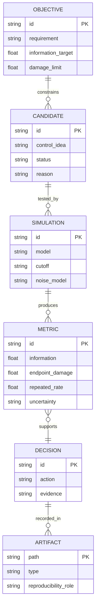

# cat qubits, from losing photons to reading a bit

this is our Alice & Bob DuQuantum 2026 submission. we started with the introductory
track because it is the quickest way to make sure the Lindblad equation, the units,
and the two-mode truncation are all behaving. then we took the standard track
seriously: measure the noise bias, build a transmon-free readout, and make the
readout pulse protect the cat as much as possible while it is being measured.

the short version is this: the buffer is not just a lossy trash can. it has a
memory, it rings, and that ringing can be made useful. our final proposal
temporarily expands the cat during readout and simultaneously corrects the
buffer's cross-Kerr frequency shift. in the stronger nonlinear stress test, this
joint control reaches the information target at `32 x 8` and `36 x 10`, lowers
endpoint damage by `20.0%` against a matched flat pulse, and reduces the extra
repeated-readout decay rate by about `89.0%` relative to the original pulse.

that is a model-backed control result, not a claim that a hardware experiment has
already proved it. the receiver comparison is deliberately reported too: on paired
noisy records, the temporary cat expansion gave `162` errors versus `182` for the
original pulse, but the confidence interval still contains no improvement. the cat
is doing something interesting; it is not allowed to fib about the statistics.

<p align="center">
  
</p>

*figure 24. the final control idea: make the cat breathe while measuring it, and
move the buffer resonance with it so cross-Kerr does not turn the measurement into
a surprise detuning experiment.*

## 1. what we actually built

the main deliverable is [`cat_qubits.ipynb`](cat_qubits.ipynb). it contains the
derivation notes, simulations, convergence studies, plots, control sweeps,
receiver checks, ablations, and the final cross-Kerr-aware proposal. the notebook
is the source of the reported numbers; the prompt's expected-behavior boxes are
sanity checks, not numbers copied into the submission.

the project has two layers:

1. **introductory track:** build the memory and buffer model from simple loss,
   through two-photon stabilization, to an actual two-mode cat state. check the
   parity logic, the logical-state preparation, and the truncation in both modes.
2. **standard track:** extract `Gamma_X` and `Gamma_Z`, simulate a buffer-mediated
   readout, compare control waveforms and classical receivers, then design a
   pulse that uses the buffer's transient dynamics instead of averaging them away.

the fun part is that the two tracks are not separate homework islands. the
introductory truncation test tells us what can be trusted in the standard track,
and the standard-track readout is built from the same memory-buffer physics that
created the cat in the first place. the buffer gets a job description.

## 2. the problem in one paragraph

we simulate a memory mode `a` coupled to a lossy buffer mode `b`. the two-photon
exchange converts two memory photons into one buffer photon and back, while the
buffer drive inflates the memory into two phase-space wells near `+alpha` and
`-alpha`. in the rotating frame used by the challenge,

$$
H_{2\mathrm{ph}} = g_2 a^2 b^\dagger + g_2 a^{\dagger 2}b
                  - \epsilon_d(b+b^\dagger),
$$

and

$$
\frac{d\rho}{dt} = -i[H_{2\mathrm{ph}},\rho]
 + \mathcal D_{\sqrt{\kappa_b}b}[\rho]
 + \mathcal D_{\sqrt{\kappa_a}a}[\rho].
$$

we use `hbar = 1`, time in microseconds, and angular rates in radians per
microsecond. the supplied parameters are

| parameter | value used |
| --- | ---: |
| `g2 / 2pi` | `0.763 MHz` |
| `kappa_b / 2pi` | `2.6 MHz` |
| `kappa_a / 2pi` | `9.3 kHz` |
| target `alpha` | `2.1` |
| target `alpha^2` | `4.41` |

the factor of `2pi` is not decorative. missing it makes a simulation look
reasonable while quietly solving a different physical problem. we put the
conversion in one place and use the same matrices for the effective and full
models.

## 3. the result a judge can check first

### 3.1 headline numbers

| check | result | where it comes from |
| --- | ---: | --- |
| semiclassical target | `alpha^2 = 4.41` | full two-mode setup |
| converged final memory population | about `4.40196` | `artifacts/cutoff_convergence.csv` |
| phase-flip scaling at `alpha = 2.1` | fitted `0.51456`, predicted `0.51538` | `artifacts/phase_flip_rates.csv` |
| bit-flip log slope | `gamma = 2.95` in the simulated zero-temperature model | `artifacts/bit_flip_rates.csv` and notebook fit |
| closed-pulse assignment error | `17.63%` in a 2048-shot validation | `artifacts/closed_assignment_summary.csv` |
| closed-pulse matched-filter error | `17.95%` on 6144 exploratory records | `artifacts/method_receiver_comparison.csv` |
| strong-`chi` joint-pulse information | `0.79066` at `32 x 8` | `artifacts/pump_detuning_chi0p30_recalibrated_32_8.csv` |
| strong-`chi` endpoint-damage improvement | `20.0%` below matched flat `1.5 us` | `artifacts/pump_detuning_chi0p30_flat_matched_32_8.csv` |
| repeated-readout extra-rate reduction | `89.0%` versus original | `artifacts/pump_detuning_nonlinear_cycles_32_8.csv` |

### 3.2 what the final proposal does

the final readout has two synchronized knobs:

- a smooth `sin^2` increase in the buffer stabilization drive during a `1.5 us`
  readout window. this makes the cat temporarily breathe outward, increasing the
  separation that the buffer can hear;
- a simultaneous buffer-frequency correction that cancels the mean cross-Kerr
  shift caused by the memory occupation. this stops the first knob from moving
  the buffer resonance away from the receiver while it is trying to listen.

the point is not “turn the pulse up.” that would be the easy idea and it costs
more logical damage. the point is to change the geometry of the measurement and
the frame in which the buffer sees it at the same time. the cat gets a little
larger, the buffer gets a little less confused, and the readout gets to use the
ringdown rather than throwing it away.

### 3.3 strong nonlinear stress test

we tested the final proposal with

```text
buffer Kerr       Kb / 2pi = 3.3 MHz
cross-Kerr        chi / 2pi = 0.30 MHz
memory dephasing  kappa_phi / 2pi = 1 kHz
```

at `32 x 8`, the fair comparison is:

| pulse | information | worst endpoint damage |
| --- | ---: | ---: |
| original pulse at the allowed cap | `0.703976` | `0.00312270` |
| flat `1.5 us`, matched signal | `0.795952` | `0.00307257` |
| flat `2.25 us`, matched signal | `0.797176` | `0.00315115` |
| cat breathing only | `0.791543` | `0.00283912` |
| detuning correction only, matched | `0.790524` | `0.00282029` |
| **joint cat breathing + detuning** | **`0.790656`** | **`0.00245814`** |

the original pulse cannot reach the `0.79` information target at the declared
drive cap in this stress model. the joint pulse can. compared with the matched
flat `1.5 us` pulse, the joint pulse lowers endpoint damage by about `20.0%`.
the ablation is important: the two controls are not just two decorative lines in
the Hamiltonian. their combination beats either single knob and has lower excess
damage than either one.

at `36 x 10`, the joint pulse gives the same information to the shown precision
(`0.790656`) and essentially the same damage (`0.00245807`). this is a control
result that survives the two tested cutoffs, not one lucky tiny Hilbert space.

### 3.4 repeated measurements

one readout is not the whole story. repeated use can turn a small disturbance
into the actual error budget, so we ran repeated nonlinear cycles and subtracted
the corresponding idle decay.

| condition | active contrast rate per `us` | idle contrast rate per `us` | extra readout rate |
| --- | ---: | ---: | ---: |
| original | `3.6012e-4` | `5.4621e-5` | `3.0550e-4` |
| joint pulse | `8.0367e-5` | `4.6802e-5` | `3.3566e-5` |

the extra rate drops by about `89.0%`. this is the strongest systems-level result
in the project, because it asks whether the idea keeps helping after the first
pretty trajectory. it also has a very specific meaning: improvement relative to
the original readout, not preservation of the completely idle cat.

## 4. introductory track: every task, with the math

we did enter the introductory track too. this section is here so a judge does
not have to infer completion from a few plots: each requested task is named,
the equation being checked is written down, and the numerical evidence is linked.
the notebook cells contain the full implementation and comments.

### 4.0 the common Lindblad setup

for every open-system calculation we use

$$
\frac{d\rho}{dt}=-i[H,\rho]+\sum_j\mathcal D_{L_j}[\rho],
\qquad
\mathcal D_L[\rho]=L\rho L^\dagger
 -\frac12\{L^\dagger L,\rho\}.
$$

the jump operator contains the square root of the rate. for example,
`L = sqrt(kappa) a` gives a one-photon loss term `kappa D_a[rho]`.
this matters because the challenge quotes ordinary frequencies but the master
equation uses angular frequencies:

$$
\omega = 2\pi f,\qquad t\text{ is in }\mu s.
$$

we use double precision and keep the memory and buffer axes explicit. no task is
being silently replaced by an adiabatically eliminated formula unless the
effective model is the thing being tested.

### 4.1 Task 1.0(a): one-photon loss

the requested single-mode warm-up uses `N = 30`, initial coherent state
`|alpha_0 = 2>`,

$$
H=\Delta a^\dagger a,
\qquad L=\sqrt{\kappa}\,a,
$$

with `Delta/(2pi) = 1 MHz` and `kappa/(2pi) = 1 MHz`. a coherent state remains
coherent under this channel:

$$
\langle a\rangle(t)=\alpha_0e^{-(\kappa/2+i\Delta)t},
\qquad
\langle n\rangle(t)=|\alpha_0|^2e^{-\kappa t}
                 =4e^{-2\pi t}.
$$

the maximum absolute photon-number difference between the Lindblad integration
and the analytic curve is `1.994e-11`, below the notebook's `2e-6` assertion.
the phase-space plot shows the expected round coherent blob spiraling inward,
not becoming a squeezed or otherwise mysterious blob.

<p align="center">
  
  
</p>

*figures 1–2. task 1.0(a): analytic photon loss and a coherent state that stays
coherent while it shrinks.*

### 4.2 Task 1.0(b): pure two-photon loss

next we set `H = 0` and use

$$
L_2=\sqrt{\kappa_2}\,a^2,
\qquad
\kappa_2=\frac{4g_2^2}{\kappa_b}.
$$

because `a^2` removes photons in pairs, it preserves photon-number parity. it
annihilates `|0>` and `|1>`, but every initially odd Fock component can cascade
down to `|1>`. for a coherent state with amplitude `alpha_0`, the total initial
odd probability is

$$
P_{\rm odd}=\sum_{m=0}^{\infty}P(2m+1)
 =\frac{1-e^{-2|\alpha_0|^2}}{2}.
$$

with `alpha_0 = 2`, this predicts

```text
P_odd = 0.499832269
final simulated <n> = 0.499832269
```

so the plateau is not an unexplained solver failure and it is not merely the
initial `P(n=1)`. it is the entire initial odd sector compressed into one photon.

<p align="center">
  
</p>

*figure 3. task 1.0(b): pair loss leaves the odd-parity population behind.*

### 4.3 Task 1.0(c): effective two-photon stabilization

the effective single-mode check uses the driven dissipator

$$
L_{\rm cat}=\sqrt{\kappa_2}\,(a^2-\alpha^2\mathbb 1),
\qquad
L_a=\sqrt{\kappa_a}\,a,
$$

with

$$
\alpha^2=\frac{\epsilon_d}{g_2},
\qquad \alpha=2.1,
\qquad \alpha^2=4.41.
$$

starting from vacuum, the memory inflates toward the two wells at `+alpha` and
`-alpha`. we reran the same evolution with `kappa_2` multiplied by `0.25`, `1`,
and `4`. when `kappa_a = 0`, multiplying `kappa_2` simply rescales the generator
and therefore rescales the time axis; with the physical nonzero `kappa_a`, the
equivalence is only approximate. the curves and Wigner snapshots are saved in
figures 4 and 5.

<p align="center">
  
  
</p>

*figures 4–5. task 1.0(c): changing the stabilization strength changes the
settling speed, while the target cat size is set by `epsilon_d/g2`.*

### 4.4 Task 1.1: full two-mode cat preparation

we then used the actual memory-buffer Hamiltonian from the prompt:

$$
H_{2\rm ph}=g_2a^2b^\dagger+g_2a^{\dagger2}b
             -\epsilon_d(b+b^\dagger),
$$

with jumps

$$
L_b=\sqrt{\kappa_b}\,b,
\qquad
L_a=\sqrt{\kappa_a}\,a.
$$

the safest tested introductory run was `N_a x N_b = 40 x 16`. it includes the
requested memory and buffer observables:

| observable | result |
| --- | ---: |
| final `<n_a>` | `4.401959` |
| target `alpha^2` | `4.410000` |
| final difference from target | `-0.182%` |
| peak `<n_a>` | `6.91112` |
| peak `<n_b>` | `1.99191` |
| maximum top-two memory population | `4.54e-7` |
| maximum top buffer population | `1.59e-6` |
| maximum trace error | `2.0e-15` |

the two adiabatic-elimination ratios are

$$
\frac{g_2}{\kappa_b}=0.2935,
\qquad
\frac{\epsilon_d}{\kappa_b}=1.2942.
$$

so `kappa_b >> g2, epsilon_d` is not satisfied. the buffer stores a couple of
photons during the transient and feeds dynamics back into the memory before it
leaks out. near either well, the linearized poles are

$$
\lambda_\pm=-\frac{\kappa_b}{4}
 \pm\sqrt{\left(\frac{\kappa_b}{4}\right)^2-(2g_2\alpha)^2}.
$$

they are complex for these parameters, which explains the overshoot and natural
ringing. the Wigner snapshots show the origin stretching, splitting into two
lobes, and developing central interference fringes. this completes the prompt's
full-model plots rather than only reporting a final photon number.

<p align="center">
  
  
</p>

*figures 6–7. task 1.1: memory and buffer transients, top-level tails, and the
full two-mode cat formation.*

### 4.5 Task 1.2: vary both Hilbert-space truncations

this is where the workshop hint mattered most. we varied `N_a` separately at
fixed `N_b = 12`, then `N_b` separately at fixed `N_a = 40`. the reference was
`40 x 16`, and the observable tolerance was declared before inspecting the
results: `0.2%` relative error for both final `<n_a>` and the transient peak.
we also recorded the populations in the top two memory levels and top buffer
level, because a final steady-state check alone can miss a bad transient.

| sweep | final population settles by | transient peak settles by | conservative choice |
| --- | ---: | ---: | ---: |
| vary `N_a`, fixed `N_b=12` | `N_a=16` | `N_a=32` | `N_a=32` |
| vary `N_b`, fixed `N_a=40` | `N_b=4` | `N_b=12` | `N_b=12` |

selected rows from [`artifacts/cutoff_convergence.csv`](artifacts/cutoff_convergence.csv):

| `N_a` | `N_b` | final `<n_a>` | peak `<n_a>` | peak `<n_b>` | memory tail | buffer tail |
| ---: | ---: | ---: | ---: | ---: | ---: | ---: |
| 16 | 12 | `4.407074` | `6.37316` | `1.99623` | `5.71e-2` | `3.59e-3` |
| 24 | 12 | `4.401970` | `6.89674` | `1.99188` | `2.00e-3` | `3.85e-4` |
| 32 | 12 | `4.401958` | `6.90843` | `1.99185` | `1.36e-5` | `1.69e-4` |
| 40 | 8 | `4.401975` | `6.74415` | `1.98065` | `3.09e-7` | `8.64e-3` |
| 40 | 12 | `4.401958` | `6.90844` | `1.99185` | `3.30e-7` | `1.69e-4` |
| 40 | 16 | `4.401959` | `6.91112` | `1.99191` | `4.54e-7` | `1.59e-6` |

the important interpretation is not simply “the number converged.” the steady
state is much less sensitive than the transient peak, and the buffer tail is
especially sensitive to `N_b`. `N_b=8` gives a plausible final memory number but
its top buffer population is still `8.64e-3`; that is exactly the kind of false
comfort the prompt warned about. the full table also includes `N_b=4,6,10` and
the suggested starting point `24 x 6`.

### 4.6 Task 1.3(a): identify the state made from vacuum

define memory parity by

$$
P=e^{i\pi a^\dagger a}.
$$

the two-photon Hamiltonian and buffer loss preserve it:

$$
[P,H_{2\rm ph}]=0,
\qquad [P,b]=0.
$$

vacuum starts even, so without memory loss the inflation stays in the even
sector. the memory-loss jump anticommutes with parity and gives

$$
\frac{d}{dt}\langle P\rangle=-2\kappa_a\langle n_aP\rangle.
$$

the natural target is therefore the even cat

$$
|\mathcal C_+\rangle=
\frac{|+\alpha\rangle+|-\alpha\rangle}
 {\sqrt{2(1+e^{-2\alpha^2})}}.
$$

we measure the memory parity, even-cat fidelity, and reduced-memory purity. the
best even-cat fidelity is `0.844302` at `t=0.630 us`. the incoherent equal
mixture has fidelity

$$
F_{+,\rm mix}=\frac{1+e^{-2\alpha^2}}{2},
$$

which is about `0.50007` at `alpha=2.1`. the simulated fidelity rises well above
that mixture baseline and the Wigner plot has negative central fringes, so the
state is not just “two classical blobs.” it is an even coherent superposition,
with loss gradually moving it away from the ideal even sector.

we also prepared an even cat directly and measured its parity `1/e` time:

```text
simulated parity 1/e time = 1.960 us
simple estimate 1/(2*kappa_a*alpha^2) = 1.940 us
maximum parity drift with kappa_a = 0 = 1.998e-15
```

the loss-free parity check is a particularly clean conservation-law test.

<p align="center">
  
</p>

*figure 8. task 1.3(a): the vacuum-prepared state is coherent and even, not an
incoherent mixture.*

### 4.7 Task 1.3(b–c): prepare a definite logical bit and price the method

to choose `|+alpha>` rather than the symmetric superposition, we add a small
phase-referenced coherent seed before the same two-mode inflation. the seed
breaks the `alpha -> -alpha` symmetry; it is not postselection after the fact.
we quantify both `Re(<a>)` and fidelity to the target coherent state:

| seed amplitude | initial photons | final `Re(<a>)` | final fidelity to `|+alpha>` |
| ---: | ---: | ---: | ---: |
| `0.0` | `0.00` | `0.000000` | `0.500020` |
| `0.5` | `0.25` | `1.441737` | `0.843560` |
| `1.0` | `1.00` | `2.007259` | `0.978297` |
| `1.5` | `2.25` | `2.093252` | `0.998781` |

the cost is an additional calibrated, phase-referenced memory displacement
control and its timing relative to the stabilizing pump. the seed preparation is
idealized as an instantaneous displacement in this notebook; a hardware version
would need finite-pulse calibration and would have to check that the seed does
not inject extra leakage. that cost is part of the answer, not hidden under the
rug.

<p align="center">
  
</p>

*figure 9. task 1.3(b–c): a phase-referenced seed selects the `+alpha` well.*

### 4.8 introductory-track checklist

| prompt request | where we answer it | evidence |
| --- | --- | --- |
| 1.0(a), analytic one-photon loss | section 4.1 and notebook cell | `01_single_photon_loss.png`, `02_shrinking_coherent.png` |
| 1.0(b), pair-loss plateau and parity explanation | section 4.2 | `03_pair_loss.png` |
| 1.0(c), stabilization strength sweep and cat | section 4.3 | `04_effective_stabilization.png`, `05_effective_cat.png` |
| 1.1, full two-mode inflation | section 4.4 | `06_full_inflation_and_tails.png`, `07_full_cat.png` |
| 1.2, separate `N_a` and `N_b` convergence | section 4.5 | `cutoff_convergence.csv` |
| 1.3(a), identify superposition vs mixture | section 4.6 | `08_which_cat.png` |
| 1.3(b), prepare a definite logical state | section 4.7 | `logical_state_preparation.csv`, `09_seeded_preparation.png` |
| 1.3(c), discuss the method's cost | section 4.7 | calibration/control discussion above |

the introductory track is therefore not just a warm-up paragraph before the
standard track. it is the model audit that tells us when the later readout
results are meaningful. the cats passed inspection; the buffer still has a
slightly dramatic personality.

## 5. standard track results

### 5.1 noise bias

the bit-flip signal is the slow decay of `Re(<a>)` from a prepared codeword. the
phase-flip signal is parity decay from an even cat. they are different observables
and different rates, so we do not mix event-rate conventions with expectation-
value decay rates.

the simulated bit-flip rates are:

| `alpha` | fitted `Gamma_X` |
| ---: | ---: |
| `0.6` | `1.3203e-2` |
| `0.8` | `6.4226e-3` |
| `1.0` | `2.3006e-3` |
| `1.2` | `5.9969e-4` |
| `1.4` | `1.1992e-4` |

a log-linear fit gives a simulated suppression exponent of about `2.95`. this is
not forced to equal a remembered experimental number: the challenge model has
zero thermal photons and the rates are only numerically tractable for smaller
cats. the fit is checked against a slow-generator eigenvalue and a larger cutoff.

for phase flips, the predicted rate is `Gamma_Z = 2 kappa_a alpha^2`. at the
target cat size:

```text
fitted Gamma_Z     = 0.51456 / us
predicted Gamma_Z  = 0.51538 / us
```

the alpha sweep follows the expected linear trend. the cat is therefore
noise-biased in the intended direction: bit flips become exponentially harder
in this model while phase flips grow approximately linearly.

<p align="center">
  
</p>

*figure 11. one of the checks that the error-rate machinery is measuring the
right thing rather than a numerical floor.*

### 5.2 readout before optimization

we use a weak real memory drive to push the two codewords in opposite directions.
the two-mode exchange transfers that difference to the buffer, so the buffer
quadrature carries the logical bit. the signal is not necessarily monotone: the
buffer is an underdamped filter, so a receiver that averages the full record can
cancel information with its own later ringdown.

for ideal homodyne records, the mean-signal information proxy is

$$
\mathcal I = \eta\kappa_b \int
  [\operatorname{Re}(b_+(t)-b_-(t))]^2\,dt.
$$

we use it to match comparisons, but we also generate noisy records and run
classical receivers. an information number is a design objective, not a magical
certificate of assignment fidelity.

the matched filter was the clear receiver winner on the same saved records:

| receiver | flat pulse error | closed pulse error |
| --- | ---: | ---: |
| full-record boxcar | `28.03%` | `50.26%` |
| drive-window boxcar | `19.87%` | `49.12%` |
| sign-following | `26.03%` | `30.14%` |
| matched filter | **`18.85%`** | **`17.95%`** |

the punchline is slightly embarrassing but useful: the better pulse needs the
better receiver. the closed pulse looks terrible to a boxcar because the boxcar
is integrating the buffer's changing sign. use the waveform you actually made.

<p align="center">
  
</p>

*figure 12. the memory wells write opposite-sign information into the buffer.*

### 5.3 control methods we tried

we compared constant, short, resonant, closed, robust-closed, and transient
controls at matched information. the nominal closed pulse was selected because
it lowered the full quantum damage while still closing the linearized endpoint.
the robust variant was kept as a real alternative, but its full quantum score
was worse. the full table is in [`artifacts/method_control_comparison.csv`](artifacts/method_control_comparison.csv).

the path to the final idea was:

1. **listen to the ringdown:** use a matched filter instead of pretending the
   buffer settles instantly;
2. **make the cat breathe:** temporarily increase the buffer stabilization drive
   during the readout so the two wells are more distinguishable;
3. **notice the nonlinear penalty:** in a buffer-Kerr/cross-Kerr/dephasing stress
   test, breathing alone loses much of its ideal-model advantage;
4. **move the resonance too:** add a synchronized buffer-frequency correction
   for the occupation-dependent cross-Kerr shift;
5. **ablate both knobs:** keep the joint control only after it beats breathing
   alone, detuning alone, and matched flat baselines.

this is why the final pulse is not just “a bigger drive.” it is a co-design of
the state geometry and the measurement frame.

<p align="center">
  
</p>

*figure 23. the earlier cat-breathing result was strong in the ideal model, but
the nonlinear stress test told us the frequency correction was needed.*

## 6. decision schema: how we chose the final method

this is intentionally written like a tiny database schema because every method
had to earn its way into the final pulse. it is a decision map, not code that has
to be executed.



| decision id | question | candidates tested | decision | evidence |
| --- | --- | --- | --- | --- |
| `D01` | can the effective model stand in for the buffer? | effective vs full two-mode | use the full model for claims about transients and readout | `cutoff_convergence.csv`, notebook intro cells |
| `D02` | does the readout need the whole waveform? | boxcar, drive-only, sign-following, matched filter | use the matched filter | `method_receiver_comparison.csv` |
| `D03` | can endpoint closure protect the cat? | flat, resonant, closed, robust closed | keep nominal closed pulse; report robust as a non-winner | `method_control_comparison.csv`, `fails.md` |
| `D04` | can a temporary cat expansion help? | flat vs breathing at matched information | keep breathing as the first creative control | `pump_breathing_*` |
| `D05` | does breathing survive nonlinearities? | ideal and Kerr/cross-Kerr/dephasing stress | do not overclaim the ideal advantage | `pump_breathing_nonlinear_comparison.csv` |
| `D06` | what is missing under cross-Kerr? | breathing, detuning, joint pulse | keep the joint pulse after ablation | `pump_detuning_chi0p30_ablation_32_8.csv` |
| `D07` | does it help more than one cycle? | original vs joint, active minus idle | report the `89.0%` extra-rate reduction | `pump_detuning_nonlinear_cycles_32_8.csv` |

the design rule that fell out of this table is simple:

```sql
-- pseudo-schema for the final choice
SELECT candidate
FROM controls
WHERE information >= 0.79
  AND endpoint_damage < matched_flat_damage
  AND repeated_extra_rate < original_extra_rate
  AND survives_cutoff_check = TRUE
  AND is_supported_by_ablation = TRUE;
```

the joint pulse is the only candidate in this study that satisfies all five
conditions in the strong-`chi` comparison. SQL joke: the buffer finally stopped
being a `SELECT * FROM noise` situation.

## 7. what failed, and why it matters

the failure log is [`fails.md`](fails.md). we kept it because a good control
story needs a graveyard, not just a trophy shelf.

the discarded ideas include:

- a short pulse with passive listening: too little information under the shared
  amplitude cap;
- a very short flat pulse: infeasible at the target information;
- a longer flat pulse: more leakage at the common endpoint;
- a robust closed pulse: better linearized exchange-frequency sensitivity but
  worse full quantum damage;
- whole-record and drive-only boxcars: they average away the changing-sign
  information;
- a geometric recovery lobe: no equal-information improvement;
- a counterdiabatic derivative correction: every nonzero tested strength made
  logical damage worse;
- random endpoint-preserving perturbations: returning the linearized mean motion
  is not enough to return the nonlinear state;
- a linear damage-aware proxy: looked attractive in the simplified model, lost in
  the full Lindblad score;
- an imaginary buffer-drive quadrature: changed information but did not beat the
  real drive ramp.

the phase-locking audit also found no sampled instability in the tested ideal
two-mode range. that is a useful negative result, not a claim of a new phase
transition. sometimes the most expensive result is “nope, that was not the
mechanism.” the simulator has opinions.

## 8. limitations and claim boundary

we think the result is interesting precisely because the boundary is explicit:

- the master equation is a rotating-wave, two-mode model;
- the final proposal includes a nonlinear stress model with buffer Kerr,
  cross-Kerr, and memory dephasing, but it is not a hardware simulation;
- the receiver uses idealized homodyne records and saved stochastic noise, not a
  calibrated amplifier chain;
- the paired noisy-record improvement from `182` to `162` errors has a 95%
  interval of approximately `[-5.4, +1.5]` percentage points for the new-minus-
  original error fraction, so it is not a resolved receiver win;
- repeated readout improvement is measured relative to the original active
  readout after subtracting idle control. it does not mean the readout is free;
- cutoff convergence is checked for the reported observables and tails, but no
  finite calculation proves an infinite-dimensional oscillator result;
- the control has a calibration boundary. changing the detuning factor too far
  can destroy the information target, so “just compensate more” is not a valid
  prescription.

the honest claim is therefore this: we found and numerically validated a
cross-Kerr-aware joint control strategy that improves a matched
information-versus-damage tradeoff and repeated-cycle readout cost in the
supplied Lindblad model. it is a strong, explainable proposal for an experiment,
not an experimental proof or a claim of a new law of physics.

that sentence is less flashy than “we solved quantum measurement forever,” but it
has the useful property of being true.

## 9. how to reproduce it

### install

```sh
python3 -m venv .venv
.venv/bin/python -m pip install -r requirements.txt
```

then select the project's `.venv` Python interpreter in Jupyter or VS Code and
open [`cat_qubits.ipynb`](cat_qubits.ipynb). run cells in order for a full fresh
reproduction. the notebook uses double precision for the slow rates and records
time in microseconds.

the authoring file [`cat_qubits.py`](cat_qubits.py) and
[`build_notebook.py`](build_notebook.py) support notebook construction and tests;
the executed notebook is the submission artifact. saved CSV/JSON/NPZ files in
[`artifacts/`](artifacts/) make the expensive comparisons inspectable and let the
later analysis sections reload verified results after a kernel restart.

### quick restart path

after restarting the kernel, the notebook can load the saved addendum and final
control results without rerunning every expensive trajectory. this is useful for
presentation day. for a from-scratch check, set the notebook's saved-result flag
to `False` and run the setup cells in order.

### files worth opening

| file | why it exists |
| --- | --- |
| [`cat_qubits.ipynb`](cat_qubits.ipynb) | full derivation, computation, plots, and report-facing outputs |
| [`artifacts/24_cross_kerr_aware_readout.png`](artifacts/24_cross_kerr_aware_readout.png) | final capstone figure |
| [`artifacts/pump_detuning_findings.md`](artifacts/pump_detuning_findings.md) | one-paragraph final numerical finding |
| [`artifacts/pump_detuning_chi0p30_recalibrated_32_8.csv`](artifacts/pump_detuning_chi0p30_recalibrated_32_8.csv) | strong-`chi` original vs joint pulse |
| [`artifacts/pump_detuning_chi0p30_ablation_32_8.csv`](artifacts/pump_detuning_chi0p30_ablation_32_8.csv) | breathing-only and detuning-only ablation |
| [`artifacts/pump_detuning_nonlinear_cycles_32_8.csv`](artifacts/pump_detuning_nonlinear_cycles_32_8.csv) | repeated-cycle rates |
| [`artifacts/cutoff_convergence.csv`](artifacts/cutoff_convergence.csv) | memory and buffer truncation study |
| [`artifacts/method_receiver_comparison.csv`](artifacts/method_receiver_comparison.csv) | fixed receiver comparison |
| [`fails.md`](fails.md) | the ideas that lost, and what each loss taught us |

## 10. last slide / the part we would say out loud

the usual readout instinct is to make the signal bigger. our result says that
the more useful question is: *what does the protected state do while we are
listening, and can we make that transient part of the measurement instead of
calling it a nuisance?*

the buffer's natural underdamped ringing is a free waveform already present in
the system. we shape the memory's temporary breathing and track the buffer's
cross-Kerr-shifted frame together. that gives a readout pulse with a measured
trade-off, a failed-method log, a truncation audit, and a clear experiment to try.

in other words: we did not just ask the cat to meow louder. we taught the buffer
when to listen. 🐈
