# detailed report: cat qubits, from losing photons to reading a bit

[start with the short submission write-up](README.md). this document keeps the
full task explanations, derivations, figures, and development history.

this is our Alice & Bob DuQuantum 2026 submission. the project started with a
pretty simple question: if the buffer naturally rings, do we have to treat that
ringing as a nuisance, or can we actually use it to read the cat?

we did the introductory track first, because there is no point optimizing a
readout for a cat that was created by a badly truncated or badly normalized
simulation. then we followed the standard track and let the model tell us which
readout idea survived.

our final proposal temporarily expands the cat during readout and compensates
the buffer's estimated cross-Kerr shift with synchronized microwave phases.
at `chi/2pi = 0.30 MHz`, it reaches the information target at `32 x 8` and
`36 x 10`, with `20.0%` less endpoint damage than a closely matched flat pulse.
a separate repeated-cycle test at `chi/2pi = 0.15 MHz` gives `89.0%` less
extra readout decay than the original pulse. those are two numerical tests with
their own calibrations.

the final nonlinear pulse now has a separate, frozen receiver audit: `14/1024`
assignment errors after `21 us`, or `1.37%` with a 95% Wilson interval of
`0.82–2.28%`. the matched flat pulse gives `9/1024`, so improved accuracy has
not been demonstrated. the joint pulse's total contrast-decay rate is about
`1.67` times its matched idle rate: idle protection fails our 10% tolerance.
section 3.5 separates these outcomes from the earlier development results.

<p align="center">
  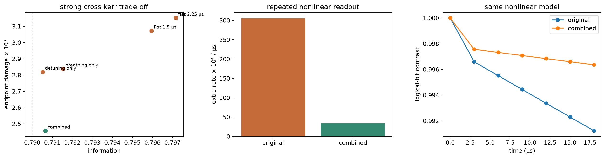
</p>

*figure 24. the final control idea: make the cat breathe while measuring it, and
track the shifted buffer with synchronized drive, pump, and receiver phases.*

## 1. what we actually built

the main deliverable is [`cat_qubits.ipynb`](cat_qubits.ipynb). it contains the
derivation notes, simulations, convergence studies, plots, control sweeps,
receiver checks, ablations, and the final cross-Kerr-aware proposal. the notebook
is the source of the reported numbers; the prompt's expected-behavior boxes are
sanity checks, not numbers copied into the submission.

the project has two layers:

1. **introductory track:** build the memory and buffer model from simple loss,
   through two-photon stabilization, to an actual two-mode cat state. check the
   parity logic, the logical-state preparation, and the truncation in both modes.
2. **standard track:** extract `Gamma_X` and `Gamma_Z`, simulate a buffer-mediated
   readout, compare control waveforms and classical receivers, then design a
   pulse that uses the buffer's transient dynamics instead of averaging them away.

the fun part is that the two tracks are not separate homework islands. the
introductory truncation test tells us what can be trusted in the standard track,
and the standard-track readout is built from the same memory-buffer physics that
created the cat in the first place. the buffer gets a job description.

### the routes we explored

we started with the simple models and flat readout. the other questions appeared
as we saw what worked, what rang, and what failed in the nonlinear stress tests:

| route | the question behind it |
| --- | --- |
| build the effective one-mode cat first | do the units, parity, and cat-state intuition work before touching the full buffer? |
| stay with a simple flat readout | how much can a conventional pulse do if we keep the comparison very clean? |
| use a resonant or closed pulse | can we shape the buffer motion so it comes back close to where it started? |
| listen to the natural ringdown | is the changing-sign transient useful if the receiver knows the waveform? |
| make the cat temporarily breathe | can a larger separation improve information without simply leaving the protected manifold? |
| derive a circuit-level readout route | can the added memory drive be connected to an actual control port instead of appearing from nowhere? |
| look for a phase-locking or recovery effect | is there a deeper dynamical feature hiding in the ringing? |
| make the breathing pulse cross-Kerr-aware | if the cat moves, can we move the buffer's frame with it? |

the later sections show what happened to each route. the cross-Kerr question
came after the breathing experiment, when its ideal-model advantage shrank under
the nonlinear stress test.

## 2. the problem in one paragraph

we simulate a memory mode `a` coupled to a lossy buffer mode `b`. the two-photon
exchange converts two memory photons into one buffer photon and back, while the
buffer drive inflates the memory into two phase-space wells near `+alpha` and
`-alpha`. in the rotating frame used by the challenge,

$$
H_{2\mathrm{ph}} = g_2 a^2 b^\dagger + g_2 a^{\dagger 2}b
                  - \epsilon_d(b+b^\dagger),
$$

and

$$
\frac{d\rho}{dt} = -i[H_{2\mathrm{ph}},\rho]
 + \mathcal D_{\sqrt{\kappa_b}b}[\rho]
 + \mathcal D_{\sqrt{\kappa_a}a}[\rho].
$$

we use `hbar = 1`, time in microseconds, and angular rates in radians per
microsecond. the supplied parameters are

| parameter | value used |
| --- | ---: |
| `g2 / 2pi` | `0.763 MHz` |
| `kappa_b / 2pi` | `2.6 MHz` |
| `kappa_a / 2pi` | `9.3 kHz` |
| target `alpha` | `2.1` |
| target `alpha^2` | `4.41` |

the factor of `2pi` is not decorative. missing it makes a simulation look
reasonable while quietly solving a different physical problem. we put the
conversion in one place and keep the physical parameters consistent between the
effective single-mode model and the full memory-buffer model.

## 3. what came out of the simulations

### 3.1 the numbers we kept

| check | result | where it comes from |
| --- | ---: | --- |
| semiclassical target | `alpha^2 = 4.41` | full two-mode setup |
| converged final memory population | about `4.40196` | `artifacts/cutoff_convergence.csv` |
| phase-flip scaling at `alpha = 2.1` | fitted `0.51456`, predicted `0.51538` | `artifacts/phase_flip_rates.csv` |
| bit-flip log slope | `gamma = 2.95` in the simulated zero-temperature model | `artifacts/bit_flip_rates.csv` and notebook fit |
| closed-pulse assignment error | `17.63%` in a 2048-shot validation | `artifacts/closed_assignment_summary.csv` |
| closed-pulse matched-filter error | `17.95%` on 6144 exploratory records | `artifacts/method_receiver_comparison.csv` |
| strong-`chi` joint-pulse information | `0.79066` at `32 x 8` | `artifacts/pump_detuning_chi0p30_recalibrated_32_8.csv` |
| strong-`chi` endpoint-damage improvement | `20.0%` below matched flat `1.5 us` | `artifacts/pump_detuning_chi0p30_flat_matched_32_8.csv` |
| repeated-readout extra-rate reduction at `chi/2pi = 0.15 MHz` | `89.0%` versus original | `artifacts/pump_detuning_nonlinear_cycles_32_8.csv` |
| final nonlinear joint-pulse assignment error, `21 us` | `14/1024 = 1.37%`, 95% interval `0.82–2.28%` | `artifacts/final_validation_receiver.csv` |
| final nonlinear active / matched-idle contrast rate | about `1.67`; preservation test fails | `artifacts/final_validation_idle_test.csv` |

### 3.2 what the final proposal does

the final readout has two synchronized knobs:

- a smooth `sin^2` increase in the buffer stabilization drive during a `1.5 us`
  readout window. this makes the cat temporarily breathe outward, increasing the
  separation that the buffer can hear;
- a prescribed detuning chosen to compensate the estimated mean cross-Kerr
  shift as the cat expands. the pump, buffer drive, and homodyne reference track
  this waveform together.

we are changing two things together: the temporary cat size and the phase
reference in which we measure the buffer. the extra buffer drive and phase
control are resources, so we count them explicitly below.

<a id="readout-phase-recipe"></a>

### 3.2.1 where the frequency correction comes from

the code applies a static correction plus a temporary ramp. its exact waveform
is

$$
r(t)=
\begin{cases}
\sin^2(\pi t/T),&0\le t<T,\\
0,&t\ge T,
\end{cases}
\qquad T=1.5\,\mu s,
$$

$$
\epsilon_B(t)=g_2\alpha^2[1+0.45r(t)],
\qquad
\Delta\omega_b(t)=-\chi\alpha^2[1+0.45r(t)].
$$

the Hamiltonian gets the term $\Delta\omega_b(t)n_b$. after the ramp, the static
$-\chi\alpha^2n_b$ correction remains during listening and recovery. this is a
waveform fixed before the run. it estimates the changing mean photon number;
it does not measure it or cancel its fluctuations.

we can produce the same effective detuning by programming the existing drive
and pump phases. let $C(t)=-\Delta\omega_b(t)$ and
$A(t)=\int_0^t C(s)\,ds$. use the following phases, with constant offsets set to
give the Hamiltonian signs above:

| control | programmed phase | angular frequency |
| --- | --- | --- |
| buffer drive | $\omega_bt+A(t)$ | $\omega_b+C(t)$ |
| exchange pump | $(2\omega_a-\omega_b)t-A(t)$ | $2\omega_a-\omega_b-C(t)$ |
| memory drive | $\omega_at$ | $\omega_a$ |
| homodyne local oscillator | same as buffer drive | $\omega_b+C(t)$ |

the pump and buffer shifts are opposite, so their summed phase stays locked to
twice the memory phase. the physical buffer frequency can stay fixed. this
frequency relation agrees with the one in Alice & Bob's
[calibration description, section D.2](https://patents.google.com/patent/EP4492296A1/en).
the time-dependent construction below is our derivation for this pulse.

in the original rotating frame, the programmed tones give

$$
\begin{aligned}
H_{\rm chirp}={}&H_{\rm nl}+H_Z(t)
+g_2[e^{-iA}a^2b^\dagger+e^{iA}a^{\dagger2}b]\\
&-\epsilon_B(t)[e^{iA}b+e^{-iA}b^\dagger],
\end{aligned}
$$

where $H_{\rm nl}$ contains the buffer Kerr and cross-Kerr terms. use
$U=e^{-iA n_b}$ and $U^\dagger bU=e^{-iA}b$ to change frame:

$$
\begin{aligned}
H_{\rm eff}
&=U^\dagger H_{\rm chirp}U-iU^\dagger\dot U\\
&=H_{\rm nl}+H_Z(t)+g_2(a^2b^\dagger+a^{\dagger2}b)
-\epsilon_B(t)(b+b^\dagger)+\Delta\omega_b(t)n_b.
\end{aligned}
$$

this recovers the simulated Hamiltonian, including its sign. the phases on the
loss jumps leave their Lindblad dissipators unchanged under our Markov model.
the receiver must also follow the frame:

$$
\beta_{\rm eff}=e^{iA}\beta_{\rm chirp},
\qquad
dY=2\sqrt{\eta\kappa_b}\operatorname{Re}[e^{iA}\beta_{\rm chirp}]\,dt+dW.
$$

that is why the local oscillator follows the buffer-drive phase: it measures the
same quadrature as our information metric. the phase accumulator continues
through ringdown and between cycles.

at the strong-cross-Kerr setting, the buffer drive and receiver shift by
$+1.323\,\mathrm{MHz}$ at idle and $+1.91835\,\mathrm{MHz}$ at the ramp peak;
the pump shifts by the opposite amounts. the temporary excursion is
$0.59535\,\mathrm{MHz}$, and the buffer-drive amplitude rises by at most 45%.

the notebook includes the phase integral and a small matrix check of the frame
mapping. this establishes equivalence within the stated rotating-wave model.
device tests still need to check phase synchronization, filtering, amplifier
response, and changes in coupling, Stark shifts, and noise across the chirp.

### 3.2.2 checking the phase recipe

we checked the Hamiltonian transformation, the Lindblad dissipators, and the
receiver operator, then independently evolved the two descriptions for
$3\,\mu s$. the maximum density-matrix difference was $4.48\times10^{-9}$ in
Frobenius norm; the tracked buffer amplitudes differed by at most
$6.69\times10^{-10}$. the Hamiltonian identity had relative error
$1.15\times10^{-14}$.

this small $4\times3$ test checks the phase prescription and signs. the cat
performance still comes from the larger cutoffs. its executable cell is at the
end of the notebook, with results in
[pump_detuning_phase_audit.json](artifacts/pump_detuning_phase_audit.json).

### 3.3 strong nonlinear stress test

we tested the final proposal with

```text
buffer Kerr       Kb / 2pi = 3.3 MHz
cross-Kerr        chi / 2pi = 0.30 MHz
memory dephasing  kappa_phi / 2pi = 1 kHz
```

all endpoints below are measured after $3\,\mu s$. to define damage, use the
normalized even and odd cats $|\mathcal C_+\rangle,|\mathcal C_-\rangle$ and
the orthogonal codewords

$$
|Z_\pm\rangle=\frac{|\mathcal C_+\rangle\pm|\mathcal C_-\rangle}{\sqrt2},
\qquad
P_{\rm code}=|\mathcal C_+\rangle\langle\mathcal C_+|
+|\mathcal C_-\rangle\langle\mathcal C_-|.
$$

for input $|s\alpha\rangle$, $s=\pm1$, and reduced memory state $\rho_{a,s}$,

$$
p_{{\rm wrong},s}=\langle Z_{-s}|\rho_{a,s}|Z_{-s}\rangle,\quad
\ell_s=1-\operatorname{Tr}(P_{\rm code}\rho_{a,s}),\quad
D=\max_s(p_{{\rm wrong},s}+\ell_s).
$$

the code space is defined at the original $\alpha=2.1$, including after the
temporary expansion. this metric counts the stored state's wrong-codeword
population and leakage. assignment error is a separate receiver statistic.

at `32 x 8`, the comparison is:

| pulse | information | worst endpoint damage |
| --- | ---: | ---: |
| original pulse at our declared cap | `0.703976` | `0.00312270` |
| flat `1.5 us`, matched signal | `0.795952` | `0.00307257` |
| flat `2.25 us`, matched signal | `0.797176` | `0.00315115` |
| cat breathing only | `0.791543` | `0.00283912` |
| detuning correction only, matched | `0.790524` | `0.00282029` |
| **joint cat breathing + detuning** | **`0.790656`** | **`0.00245814`** |

the original closed waveform cannot reach the `0.79` target at our
`max |epsilon_Z| / g2 = 0.5` cap. the joint pulse can. the flat baselines have
about 0.7–0.8% more mean-signal information than the joint pulse, so these are
closely matched comparisons rather than exact equality. the endpoint reduction
against the `1.5 us` flat pulse is `20.0%` at the listed settings.

we hold the memory-drive cap and total observation time fixed. the joint pulse
additionally uses a 45% buffer-drive amplitude increase and the frequency/phase
control above. it therefore spends extra control resources. its two single-knob
ablations also have higher endpoint damage.

at `36 x 10`, the joint pulse gives the same information to the shown precision
(`0.790656`) and essentially the same damage (`0.00245807`). this is a control
result that survives the two tested cutoffs, not one lucky tiny Hilbert space.

### 3.4 repeated measurements

one readout is not the whole story. we also tested six consecutive `3 us`
cycles with no buffer reset. this experiment uses `chi/2pi = 0.15 MHz`,
`32 x 8`, buffer Kerr `3.3 MHz`, and memory dephasing `1 kHz`.
the joint control has buffer fraction `0.45`, detuning factor `1.5`, and
memory-drive scale `1.190`; the original uses memory-drive scale `1.166`.
these settings differ from the stronger-cross-Kerr endpoint experiment.

we initialize the orthogonal codeword $|Z_+\rangle$ and fit the decay of
$C(t)=\langle P_{Z_+}-P_{Z_-}\rangle$ at cycle boundaries 2 through 6.
each protocol's idle control switches off the memory readout drive while keeping
its buffer controls. the reported extra rate is

$$
\Gamma_{\rm extra}=\Gamma_{\rm active}-\Gamma_{\rm idle}.
$$

| condition | active contrast rate per `us` | idle contrast rate per `us` | extra readout rate |
| --- | ---: | ---: | ---: |
| original | `3.6012e-4` | `5.4621e-5` | `3.0550e-4` |
| joint pulse | `8.0367e-5` | `4.6802e-5` | `3.3566e-5` |

the extra rate drops by about `89.0%`. this tests the accumulating cost of the
readout under a specified schedule. it is a fitted contrast-decay rate, distinct
from the stationary $\Gamma_X$ in Task 2.1. the joint readout still adds decay
above its own idle control. settings are recorded in
[pump_detuning_cycle_settings.json](artifacts/pump_detuning_cycle_settings.json).

### 3.5 the final claim audit: can we read it, and does it stay protected?

the feedback identified two missing tests. a pulse can leave less endpoint
damage without accurately assigning the input bit. it can also beat another
readout while still losing protection relative to doing no readout. we froze
[a separate audit plan](artifacts/final_validation_plan.json) before generating
its samples, with the final `chi/2pi = 0.30 MHz` controls unchanged.

we use `alpha = 2.1`, buffer Kerr `3.3 MHz`, and memory dephasing `1 kHz`.
the joint control has buffer fraction `0.45`, detuning factor `1`, and memory
scale `1.185`. the flat baseline has a `1.5 us` window, `20 ns` edges, and
memory-drive peak `0.374 g2`. both repeat seven `3 us` cycles with no buffer or
memory reset. each input is initially a coherent state near one codeword, with
the buffer in vacuum. this is a test of the initial bit, using the full record;
it does not assume the bit is unchanged at the endpoint.

#### assignment uses the measured channel

the receiver sees the buffer homodyne record only. all dissipative channels are
unraveled to keep pure-state trajectories affordable, but the simulated memory
loss and dephasing records are discarded before classification. neither the
hidden state nor the true input label is supplied to the classifier.

for each protocol, deterministic master-equation signals fix the receiver:

$$
\mu_\pm(t)=2\sqrt{\kappa_b}\,\operatorname{Re}\langle b\rangle_\pm(t),
\qquad w(t)=\mu_+(t)-\mu_-(t),
$$

$$
S=\frac{\displaystyle\int_0^{t_f}w(t)
\left[dY_t-\frac{\mu_+(t)+\mu_-(t)}2\,dt\right]}
{\displaystyle\sqrt{\int_0^{t_f}w(t)^2\,dt}}.
$$

positive `S` assigns the positive initial bit; zero is counted as an error.
midpoint subtraction removes common buffer offsets. the threshold is fixed at
zero before sampling; we do not fit it to the validation labels. the homodyne
reference follows the chirped frame derived in section 3.2.1. detector efficiency
is `1`, so this is simulated ideal detection, not a hardware-fidelity result.

the primary sample is `512` independent records per input, `24 x 6` cutoff,
stochastic step `0.0002 us`, and fixed seed `73261025`. the primary horizon is
`21 us`; `3 us` is a predeclared secondary result. the audit's accuracy criterion
is a 95% upper assignment-error bound below `5%`. that is our operational
criterion, not a threshold specified by the organizers.

| protocol | errors after `3 us` | errors after `21 us` | `21 us` error, 95% Wilson interval |
| --- | ---: | ---: | --- |
| joint pulse | `209/1024` | `14/1024` | `1.37%`, `0.82–2.28%` |
| matched flat pulse | `187/1024` | `9/1024` | `0.88%`, `0.46–1.66%` |

the final joint pulse passes the absolute accuracy criterion at `21 us`, but
not at `3 us`. the flat pulse also passes at `21 us`. lower damage has not
turned into a demonstrated accuracy advantage. the paired comparison uses
common noise seeds across protocols and conservative exact bounds on the two
discordant-error counts. at `21 us`, joint minus flat is `+0.49` percentage
points, with a conservative 95% interval of `[-1.10, +2.07]` percentage points;
its result is saved in
[final_validation_accuracy_comparison.csv](artifacts/final_validation_accuracy_comparison.csv).

#### idle protection gets its own denominator

we evolve both inputs with the deterministic master equation and form

$$
C(t)=\frac{\operatorname{Tr}[Z\rho_+(t)]-
\operatorname{Tr}[Z\rho_-(t)]}{2},
\qquad Z=P_{Z_+}-P_{Z_-}.
$$

at cycle boundaries, we fit `log C = intercept - rate * time`, starting at
cycle `2` through cycle `7`. the idle control removes the memory readout drive
and retains the joint buffer ramp and detuning. this gives the additional cost
of turning on readout with those auxiliary controls already present. we also
report the original idle with all added controls removed.

| protocol, `32 x 8` | total contrast-decay rate per `us` |
| --- | ---: |
| joint active | `1.077963e-4` |
| joint matched idle | `6.454912e-5` |
| original active | `3.112266e-4` |
| original idle | `5.178487e-5` |
| matched flat active | `2.821067e-4` |

the active / matched-idle ratio is `1.66999`, above our predeclared `1.10`
limit. relative to the unmodified original idle, the joint rate is about
`2.08` times higher. reduced extra readout decay is useful, but the current
pulse does not preserve the idle protection. these are finite-time,
cycle-boundary contrast rates; they are distinct from Task 2.1's stationary
generator rates and from a direct count of individual bit-flip events.

as an additional post-audit diagnostic, we divide each input's logical
expectation by its code-space population before forming the contrast. the
joint and idle fitted rates remain `1.077963e-4` and `6.454911e-5` per `us`.
their code populations drift by less than `2.2e-10` over the fitted cycle
boundaries, so accumulating leakage does not explain the excess contrast
decay. [the diagnostic table](artifacts/final_validation_code_population.csv)
records all five protocols. this supplements the frozen test; it does not
replace its observable or threshold, or establish protection across cat sizes.

#### checks that can actually reject a result

we repeat the joint and idle density-matrix calculation at `36 x 10`, tighten
`rtol/atol` from `2e-10/2e-12` to `5e-11/5e-13`, and start the fit at cycles
`2`, `3`, and `4`. the active rate changes by about `0.0403%` on increasing the
cutoff, while the idle rate changes by about `0.0127%`; tighter tolerances change
them by less than `1e-12` per `us`. this is far too small to explain a 67%
excess over idle. the sensitivity bounds in
[the preservation test](artifacts/final_validation_idle_test.csv) span
`1.66906–1.67092`. they combine these
changes, fit residual uncertainty, and a `1e-8/us` numerical floor. they are
numerical indicators, not statistical confidence intervals. trace, boundary
population, and final density-matrix eigenvalue checks are saved with the rates;
small negative eigenvalues from the non-positivity-preserving ODE solver are
reported explicitly rather than silently clipped.

the stochastic calculation also has an ensemble check. an initial fast scheme
normalized each ket but omitted the full Kraus-map normalization. on this long
nonlinear run it gave about `8.05` memory photons, against the master equation's
`4.406`. those apparent assignment scores are rejected and retained in
[the numerical failure record](artifacts/final_validation_rejected_numerics.json).
the repaired calculation normalizes the full Rouchon map and tests completeness,
sparse versus dense Hamiltonian actions, and a full one-step update. the main
joint sample gives `4.40046` photons with standard error `0.00538`, versus
deterministic `4.40586`; the artificial heating is gone at this check's resolution.

to make that calculation affordable, the Hamiltonian and state-independent
normalizer are precomputed at `5 ns` midpoint bins. the refinement sample halves
both the stochastic step and those bins, so an error in either discretization
can appear. an independent larger-cutoff sample uses `32 x 8`. each check has
`128` records per input with its own fixed seed. we require a conservative 95%
error-difference interval inside `±3` percentage points to call equivalence
supported; otherwise it remains unresolved. the complete outcomes are in
[the receiver convergence table](artifacts/final_validation_receiver_convergence.csv)
and [generated findings](artifacts/final_validation_findings.md). the joint
half-step sample gives `3/256` errors (`1.17%`); its conservative difference
interval is `[-2.24, +3.07]` percentage points relative to the main run.
that narrowly misses the predeclared `±3`-point equivalence margin. agreement
of the point estimates does not resolve that statistical uncertainty, so full
receiver convergence is not claimed. the larger-cutoff joint sample gives
`2/256` errors (`0.78%`) and supports that equivalence margin. controls,
sample counts, horizons, seeds, and claim thresholds were kept fixed through
the solver repair, which is recorded in
[final_validation_numerics.json](artifacts/final_validation_numerics.json).
the [implementation check record](artifacts/final_validation_implementation_checks.json)
also reruns the operator, full-step, and completeness assertions from the
submitted notebook source for both protocols and all three numerical settings.

the audit independently reproduces the old first-cycle information within
`8.9e-16` and endpoint damage within `9.9e-13`.
the final notebook section contains the whole audit implementation and can
reload the frozen evidence or recompute it. its summary records each claim
separately; `both_requested_claims_supported` is false because idle protection
fails. that failure is part of our result, not a box to tick after code runs.

## 4. introductory track: every task, with the math

we did enter the introductory track too. this section is here so a judge does
not have to infer completion from a few plots: each requested task is named,
the equation being checked is written down, and the numerical evidence is linked.
the notebook cells contain the full implementation and comments.

### 4.0 the common Lindblad setup

for every open-system calculation we use

$$
\frac{d\rho}{dt}=-i[H,\rho]+\sum_j\mathcal D_{L_j}[\rho],
\qquad
\mathcal D_L[\rho]=L\rho L^\dagger
 -\frac12\{L^\dagger L,\rho\}.
$$

the jump operator contains the square root of the rate. for example,
`L = sqrt(kappa) a` gives a one-photon loss term `kappa D_a[rho]`.
this matters because the challenge quotes ordinary frequencies but the master
equation uses angular frequencies:

$$
\omega = 2\pi f,\qquad t\text{ is in }\mu s.
$$

we use double precision and keep the memory and buffer axes explicit. no task is
being silently replaced by an adiabatically eliminated formula unless the
effective model is the thing being tested.

### 4.1 Task 1.0(a): one-photon loss

the requested single-mode warm-up uses `N = 30`, initial coherent state
`|alpha_0 = 2>`,

$$
H=\Delta a^\dagger a,
\qquad L=\sqrt{\kappa}\,a,
$$

with `Delta/(2pi) = 1 MHz` and `kappa/(2pi) = 1 MHz`. a coherent state remains
coherent under this channel:

$$
\langle a\rangle(t)=\alpha_0e^{-(\kappa/2+i\Delta)t},
\qquad
\langle n\rangle(t)=|\alpha_0|^2e^{-\kappa t}
                 =4e^{-2\pi t}.
$$

the maximum absolute photon-number difference between the Lindblad integration
and the analytic curve is `1.994e-11`, below the notebook's `2e-6` assertion.
the phase-space plot shows the expected round coherent blob spiraling inward,
not becoming a squeezed or otherwise mysterious blob.

<p align="center">
  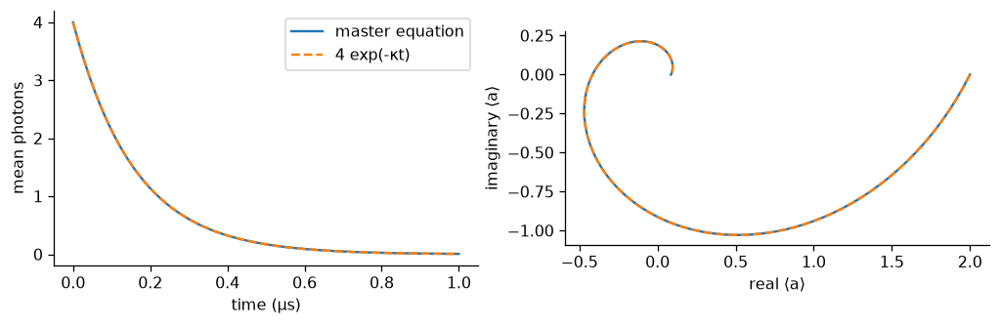
  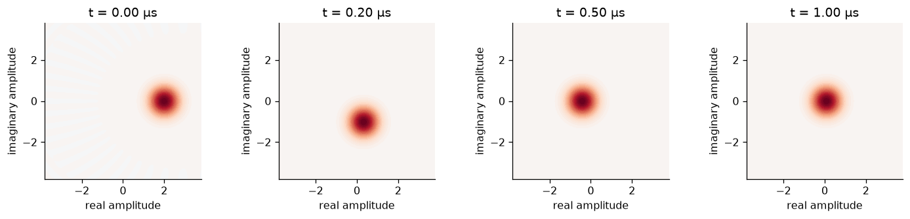
</p>

*figures 1–2. task 1.0(a): analytic photon loss and a coherent state that stays
coherent while it shrinks.*

### 4.2 Task 1.0(b): pure two-photon loss

next we set `H = 0` and use

$$
L_2=\sqrt{\kappa_2}\,a^2,
\qquad
\kappa_2=\frac{4g_2^2}{\kappa_b}.
$$

because `a^2` removes photons in pairs, it preserves photon-number parity. it
annihilates `|0>` and `|1>`, but every initially odd Fock component can cascade
down to `|1>`. for a coherent state with amplitude `alpha_0`, the total initial
odd probability is

$$
P_{\rm odd}=\sum_{m=0}^{\infty}P(2m+1)
 =\frac{1-e^{-2|\alpha_0|^2}}{2}.
$$

with `alpha_0 = 2`, this predicts

```text
P_odd = 0.499832269
final simulated <n> = 0.499832269
```

so the plateau is not an unexplained solver failure and it is not merely the
initial `P(n=1)`. it is the entire initial odd sector compressed into one photon.

<p align="center">
  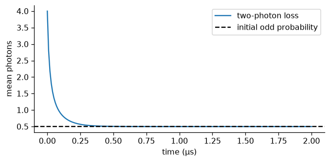
</p>

*figure 3. task 1.0(b): pair loss leaves the odd-parity population behind.*

### 4.3 Task 1.0(c): effective two-photon stabilization

the effective single-mode check uses the driven dissipator

$$
L_{\rm cat}=\sqrt{\kappa_2}\,(a^2-\alpha^2\mathbb 1),
\qquad
L_a=\sqrt{\kappa_a}\,a,
$$

with

$$
\alpha^2=\frac{\epsilon_d}{g_2},
\qquad \alpha=2.1,
\qquad \alpha^2=4.41.
$$

starting from vacuum, the memory inflates toward the two wells at `+alpha` and
`-alpha`. we reran the same evolution with `kappa_2` multiplied by `0.25`, `1`,
and `4`. when `kappa_a = 0`, multiplying `kappa_2` simply rescales the generator
and therefore rescales the time axis; with the physical nonzero `kappa_a`, the
equivalence is only approximate. the curves and Wigner snapshots are saved in
figures 4 and 5.

<p align="center">
  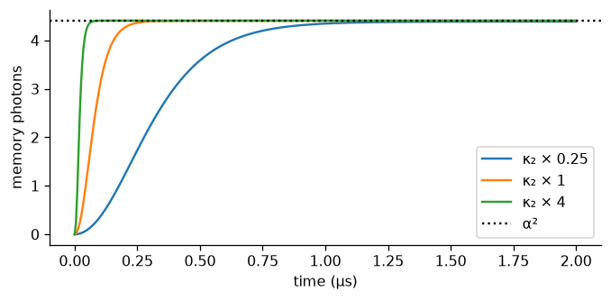
  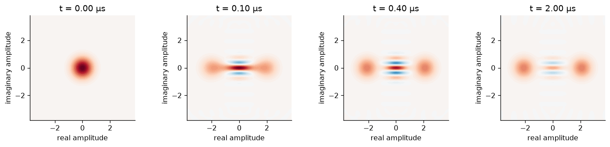
</p>

*figures 4–5. task 1.0(c): changing the stabilization strength changes the
settling speed, while the target cat size is set by `epsilon_d/g2`.*

### 4.4 Task 1.1: full two-mode cat preparation

we then used the actual memory-buffer Hamiltonian from the prompt:

$$
H_{2\rm ph}=g_2a^2b^\dagger+g_2a^{\dagger2}b
             -\epsilon_d(b+b^\dagger),
$$

with jumps

$$
L_b=\sqrt{\kappa_b}\,b,
\qquad
L_a=\sqrt{\kappa_a}\,a.
$$

the safest tested introductory run was `N_a x N_b = 40 x 16`. it includes the
requested memory and buffer observables:

| observable | result |
| --- | ---: |
| final `<n_a>` | `4.401959` |
| target `alpha^2` | `4.410000` |
| final difference from target | `-0.182%` |
| peak `<n_a>` | `6.91112` |
| peak `<n_b>` | `1.99191` |
| maximum top-two memory population | `4.54e-7` |
| maximum top buffer population | `1.59e-6` |
| maximum trace error | `2.0e-15` |

the integrator's smallest reduced-state eigenvalue in this run is about
$-1.74\times10^{-6}$. this is a finite numerical positivity error; a small trace
error alone does not certify positivity. the notebook also checks tighter
integration and a finer output grid.

the two adiabatic-elimination ratios are

$$
\frac{g_2}{\kappa_b}=0.2935,
\qquad
\frac{\epsilon_d}{\kappa_b}=1.2942.
$$

so `kappa_b >> g2, epsilon_d` is not satisfied. the buffer stores a couple of
photons during the transient and feeds dynamics back into the memory before it
leaks out. near either well, the linearized poles are

$$
\lambda_\pm=-\frac{\kappa_b}{4}
 \pm\sqrt{\left(\frac{\kappa_b}{4}\right)^2-(2g_2\alpha)^2}.
$$

they are complex for these parameters, which explains the overshoot and natural
ringing. the Wigner snapshots show the origin stretching, splitting into two
lobes, and developing central interference fringes. this completes the prompt's
full-model plots rather than only reporting a final photon number.

<p align="center">
  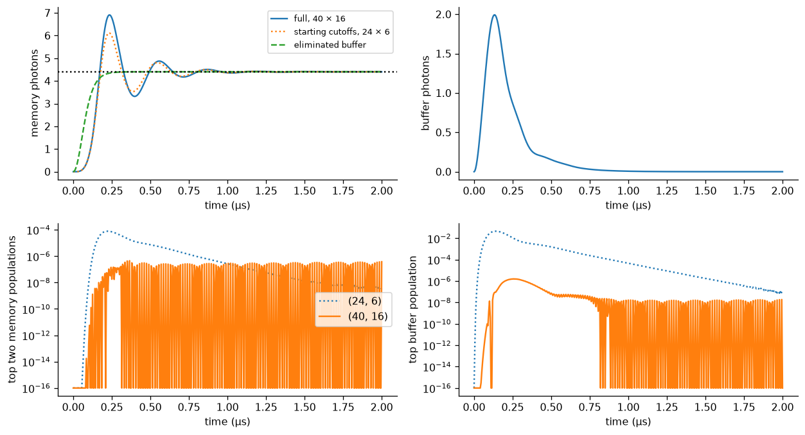
  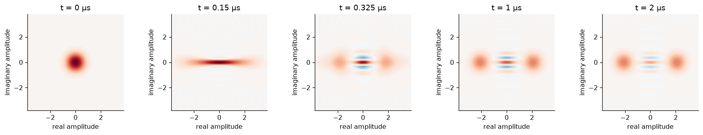
</p>

*figures 6–7. task 1.1: memory and buffer transients, top-level tails, and the
full two-mode cat formation.*

### 4.5 Task 1.2: vary both Hilbert-space truncations

this is where the workshop hint mattered most. we varied `N_a` separately at
fixed `N_b = 12`, then `N_b` separately at fixed `N_a = 40`. the reference was
`40 x 16`, and the observable tolerance was declared before inspecting the
results: `0.2%` relative error for both final `<n_a>` and the transient peak.
we also recorded the populations in the top two memory levels and top buffer
level, because a final steady-state check alone can miss a bad transient.

| sweep | final population settles by | transient peak settles by | conservative choice |
| --- | ---: | ---: | ---: |
| vary `N_a`, fixed `N_b=12` | `N_a=16` | `N_a=32` | `N_a=32` |
| vary `N_b`, fixed `N_a=40` | `N_b=4` | `N_b=12` | `N_b=12` |

selected rows from [`artifacts/cutoff_convergence.csv`](artifacts/cutoff_convergence.csv):

| `N_a` | `N_b` | final `<n_a>` | peak `<n_a>` | peak `<n_b>` | memory tail | buffer tail |
| ---: | ---: | ---: | ---: | ---: | ---: | ---: |
| 16 | 12 | `4.407074` | `6.37316` | `1.99623` | `5.71e-2` | `3.59e-3` |
| 24 | 12 | `4.401970` | `6.89674` | `1.99188` | `2.00e-3` | `3.85e-4` |
| 32 | 12 | `4.401958` | `6.90843` | `1.99185` | `1.36e-5` | `1.69e-4` |
| 40 | 8 | `4.401975` | `6.74415` | `1.98065` | `3.09e-7` | `8.64e-3` |
| 40 | 12 | `4.401958` | `6.90844` | `1.99185` | `3.30e-7` | `1.69e-4` |
| 40 | 16 | `4.401959` | `6.91112` | `1.99191` | `4.54e-7` | `1.59e-6` |

the important interpretation is not simply “the number converged.” the steady
state is much less sensitive than the transient peak, and the buffer tail is
especially sensitive to `N_b`. `N_b=8` gives a plausible final memory number but
its top buffer population is still `8.64e-3`; that is exactly the kind of false
comfort the prompt warned about. the full table also includes `N_b=4,6,10` and
the suggested starting point `24 x 6`.

halving the output spacing and tightening integration at `32 x 12` changes the
sampled peak by `8.76e-9` photons and matched-time populations by at most
`9.02e-8`. the reference population varies by about `0.180%` of $\alpha^2$ over
the last $0.5\,\mu s$, so “final” means the late value in this finite observation
window. a semiclassical estimate including memory loss gives

$$
n_{a,\rm sc}=\alpha^2-\frac{\kappa_a\kappa_b}{8g_2^2}=4.404808.
$$

the converged quantum result is close to this estimate and slightly below the
lossless target $4.41$.

### 4.6 Task 1.3(a): identify the state made from vacuum

define memory parity by

$$
P=e^{i\pi a^\dagger a}.
$$

the two-photon Hamiltonian and buffer loss preserve it:

$$
[P,H_{2\rm ph}]=0,
\qquad [P,b]=0.
$$

vacuum starts even, so without memory loss the inflation stays in the even
sector. the memory-loss jump anticommutes with parity and gives

$$
\frac{d}{dt}\langle P\rangle=-2\kappa_a\langle n_aP\rangle.
$$

the natural target is therefore the even cat

$$
|\mathcal C_+\rangle=
\frac{|+\alpha\rangle+|-\alpha\rangle}
 {\sqrt{2(1+e^{-2\alpha^2})}}.
$$

we measure the memory parity, squared pure-state fidelity, and reduced-memory
purity:

$$
F_+(t)=\langle\mathcal C_+|\rho_a(t)|\mathcal C_+\rangle,\qquad
\mathcal P(t)=\operatorname{Tr}[\rho_a(t)^2].
$$

the best even-cat fidelity is `0.844302` at `t=0.630 us`. the incoherent equal
mixture has fidelity

$$
F_{+,\rm mix}=\frac{1+e^{-2\alpha^2}}{2},
$$

which is about `0.50007` at `alpha=2.1`. the simulated fidelity rises well above
that mixture baseline and the Wigner plot has negative central fringes, so the
state is not just “two classical blobs.” it is an even coherent superposition,
with loss gradually moving it away from the ideal even sector.

we also prepared an even cat directly and measured its parity `1/e` time:

```text
simulated parity 1/e time = 1.960 us
simple estimate 1/(2*kappa_a*alpha^2) = 1.940 us
maximum parity drift with kappa_a = 0 = 1.998e-15
```

the loss-free parity check is a particularly clean conservation-law test.

<p align="center">
  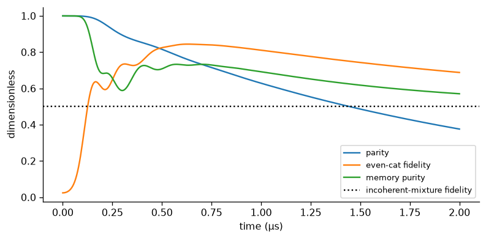
</p>

*figure 8. task 1.3(a): the vacuum-prepared state is coherent and even, not an
incoherent mixture.*

<a id="logical-state-preparation"></a>

### 4.7 Task 1.3(b–c): prepare a definite logical bit and price the method

to choose `|+alpha>` rather than the symmetric superposition, we add a small
phase-referenced coherent seed before the same two-mode inflation. the seed
breaks the `alpha -> -alpha` symmetry; it is not postselection after the fact.
we quantify both `Re(<a>)` and fidelity to the target coherent state:

| seed amplitude | initial photons | final `Re(<a>)` | final fidelity to the positive codeword |
| ---: | ---: | ---: | ---: |
| `0.0` | `0.00` | `0.000000` | `0.500020` |
| `0.5` | `0.25` | `1.441737` | `0.843560` |
| `1.0` | `1.00` | `2.007259` | `0.978297` |
| `1.5` | `2.25` | `2.093252` | `0.998781` |

the cost is an additional calibrated, phase-referenced memory displacement
control and its timing relative to the stabilizing pump. the seed preparation is
idealized as an instantaneous displacement in this notebook; a hardware version
would need finite-pulse calibration and would have to check that the seed does
not inject extra leakage. that cost is part of the answer, not hidden under the
rug.

<p align="center">
  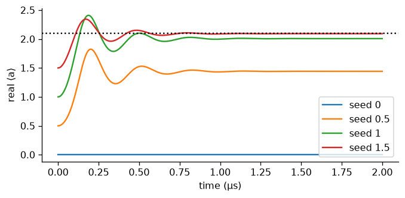
</p>

*figure 9. task 1.3(b–c): a phase-referenced seed selects the `+alpha` well.*

### 4.8 introductory-track checklist

| prompt request | where we answer it | evidence |
| --- | --- | --- |
| 1.0(a), analytic one-photon loss | section 4.1 and notebook cell | `01_single_photon_loss.png`, `02_shrinking_coherent.png` |
| 1.0(b), pair-loss plateau and parity explanation | section 4.2 | `03_pair_loss.png` |
| 1.0(c), stabilization strength sweep and cat | section 4.3 | `04_effective_stabilization.png`, `05_effective_cat.png` |
| 1.1, full two-mode inflation | section 4.4 | `06_full_inflation_and_tails.png`, `07_full_cat.png` |
| 1.2, separate `N_a` and `N_b` convergence | section 4.5 | `cutoff_convergence.csv` |
| 1.3(a), identify superposition vs mixture | section 4.6 | `08_which_cat.png` |
| 1.3(b), prepare a definite logical state | section 4.7 | `logical_state_preparation.csv`, `09_seeded_preparation.png` |
| 1.3(c), discuss the method's cost | section 4.7 | calibration/control discussion above |

the introductory track is therefore not just a warm-up paragraph before the
standard track. it is the model audit that tells us when the later readout
results are meaningful. the cats passed inspection; the buffer still has a
slightly dramatic personality.

## 5. standard track results

### 5.1 Tasks 2.1–2.2: noise bias

the bit-flip signal is the slow decay of `Re(<a>)` from a prepared codeword. the
phase-flip signal is parity decay from an even cat. they are different observables
and different rates, so we do not mix event-rate conventions with expectation-
value decay rates.

the simulated bit-flip rates are:

| `alpha` | fitted `Gamma_X` per `us` |
| ---: | ---: |
| `0.6` | `1.3203e-2` |
| `0.8` | `6.4226e-3` |
| `1.0` | `2.3006e-3` |
| `1.2` | `5.9969e-4` |
| `1.4` | `1.1992e-4` |

a log-linear fit over $\alpha=0.6$ through $1.4$ gives

$$
\Gamma_X\simeq A_X e^{-\gamma\alpha^2},\qquad \gamma=2.9545.
$$

the notebook compares time-domain fits with a slow eigenvalue of the full
two-mode generator and repeats the calculation at larger cutoffs. this finite
range gives $\gamma>2$, rather than the slide deck's coarse $\gamma\lesssim2$
reference. the zero-temperature model, prefactors, finite fit range, and
memory-buffer dynamics matter; the fit does not establish a universal exponent
or a lifetime at $\alpha=2.1$.

the direct coherent-state matrix element gives a different naive estimate:

$$
\langle-\alpha|a|\alpha\rangle=\alpha e^{-2\alpha^2},
\qquad
|\langle-\alpha|a|\alpha\rangle|^2=\alpha^2e^{-4\alpha^2}.
$$

that estimate only counts direct overlap. the Lindblad evolution also includes
excursions outside the code space and their dissipative recovery, so its fitted
decay need not have that exponent. rates here describe expectation-value decay;
for a symmetric classical bit with single-event rate $r$, $\Gamma_X=2r$.

for phase flips, the predicted rate is `Gamma_Z = 2 kappa_a alpha^2`. at the
target cat size:

```text
fitted Gamma_Z     = 0.51456 / us
predicted Gamma_Z  = 0.51538 / us
```

the fitted slope is `0.116684` per `us` per unit $\alpha^2$, compared with
$2\kappa_a=0.116867$. the alpha sweep follows the expected linear trend. the cat is therefore
noise-biased in the intended direction: bit flips become exponentially harder
in this model while phase flips grow approximately linearly.

<p align="center">
  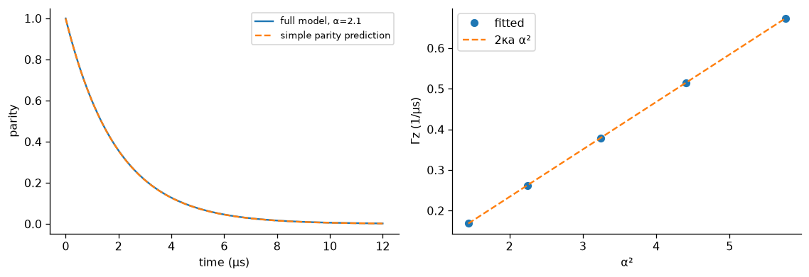
</p>

*figure 11. one of the checks that the error-rate machinery is measuring the
right thing rather than a numerical floor.*

### 5.2 Task 2.3: readout before optimization

we use a weak real memory drive to push the two codewords in opposite directions.
the two-mode exchange transfers that difference to the buffer, so the buffer
quadrature carries the logical bit. the signal is not necessarily monotone: the
buffer is an underdamped filter, so a receiver that averages the full record can
cancel information with its own later ringdown.

with $\epsilon_Z=0.1g_2$ at $\alpha=2.1$, the linearized plateau is

$$
\beta_{\pm,\rm ss}\simeq\mp\frac{\epsilon_Z}{2\alpha g_2},
\qquad
\operatorname{Re}(\beta_+-\beta_-)\simeq-\frac{\epsilon_Z}{\alpha g_2}.
$$

the simulated contrast is `-0.047576`, versus `-0.047619` from the estimate.
it settles within 2% of the late-window plateau by `0.815 us`; the linearized
ringing period is `0.319 us`. this plateau is a metastable readout signal:
rare bit flips eventually remove the initial-bit contrast.

for ideal homodyne records, the mean-signal information proxy is

$$
\mathcal I = \eta\kappa_b \int
  [\operatorname{Re}(b_+(t)-b_-(t))]^2\,dt.
$$

we use it to match comparisons, but we also generate noisy records and run
classical receivers. an information number is a design objective, not a magical
certificate of assignment fidelity.

the matched filter was the clear receiver winner on the same saved records:

| receiver | flat pulse error | closed pulse error |
| --- | ---: | ---: |
| full-record boxcar | `28.03%` | `50.26%` |
| drive-window boxcar | `19.87%` | `49.12%` |
| sign-following | `26.03%` | `30.14%` |
| matched filter | **`18.85%`** | **`17.95%`** |

the punchline is slightly embarrassing but useful: the better pulse needs the
better receiver. the closed pulse looks terrible to a boxcar because the boxcar
is integrating the buffer's changing sign. use the waveform you actually made.

<p align="center">
  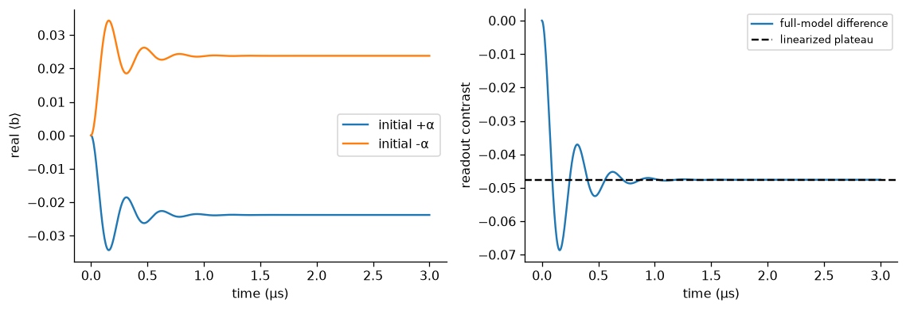
</p>

*figure 12. the memory wells write opposite-sign information into the buffer.*

<a id="circuit-drive"></a>

### 5.3 Task 2.4(a): how the control enters the circuit

the notebook derives two memory-drive routes. our numerical protocol uses a
capacitive memory port:

$$
H_{\rm port}=2\epsilon_Z(t)\cos(\omega_at+\theta)(a+a^\dagger)
\quad\longrightarrow\quad
H_Z=\epsilon_Z(t)(e^{i\theta}a+e^{-i\theta}a^\dagger)
$$

after the rotating-wave approximation. setting $\theta=0$ gives the real drive
used in Task 2.3. the control requires a calibrated memory port, with its
associated coupling and loss cost.

the alternative of adding a flux tone at $\omega_a$ also generates nonlinear
readout terms. to cubic order, the resonant terms are

$$
E_J\epsilon_r\varphi_a
\left[
\left(1-\frac{\varphi_a^2+\varphi_b^2}{2}\right)(a+a^\dagger)
-\frac{\varphi_a^2}{2}(a^\dagger a^2+a^{\dagger2}a)
-\varphi_b^2(a+a^\dagger)n_b
\right].
$$

the exchange pump has its own higher-order corrections: at fifth order, its
forward Fock-state matrix element is multiplied by

$$
1-\frac{\varphi_a^2}{6}(2n_a-1)-\frac{\varphi_b^2}{2}(n_b+1).
$$

the circuit test retains resonant matrix elements of the full sine, rather than
integrating GHz oscillations over every microsecond. the pump phase sets our
positive-$g_2$ convention. this checks number-dependent resonant corrections;
off-resonant virtual processes and hardware noise remain outside that test.
the separate Kerr stress parameters are explicit model additions.

### 5.4 Task 2.4(b): stronger readout has a cost

we sweep the memory drive at $\alpha=1.2$, where the bit-decay rate remains
numerically accessible. the larger-cutoff results are:

| $\epsilon_Z/g_2$ | late-window buffer contrast | $\Gamma_X$ per $\mu s$ |
| ---: | ---: | ---: |
| 0.00 | 0.00000 | 0.00059994 |
| 0.05 | 0.04045 | 0.00316789 |
| 0.10 | 0.07927 | 0.0109591 |
| 0.20 | 0.14559 | 0.0437387 |
| 0.40 | 0.19224 | 0.207910 |

the signal increases, but the slow bit mode decays faster as the readout pushes
the memory farther from its protected wells. these are the small-cat DC rates
from [dc_readout_tradeoff.csv](artifacts/dc_readout_tradeoff.csv), distinct from
the finite-pulse damage at $\alpha=2.1$.

<p align="center">
  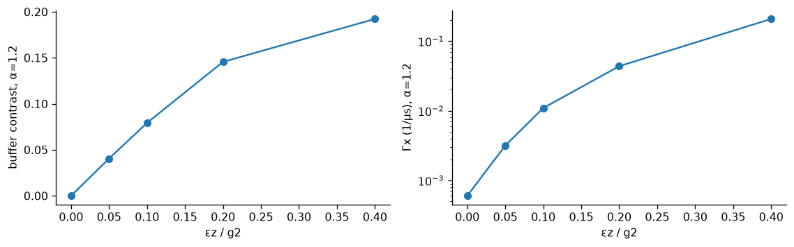
</p>

### 5.5 Tasks 2.4(c–d): control methods and evidence

we compared constant, short, resonant, closed, robust-closed, and transient
controls at matched information. the nominal closed pulse was selected because
it lowered the full quantum damage while still closing the linearized endpoint.
the robust variant was kept as a real alternative, but its full quantum score
was worse. the full table is in [`artifacts/method_control_comparison.csv`](artifacts/method_control_comparison.csv).

the path to the final idea was:

1. **listen to the ringdown:** use a matched filter instead of pretending the
   buffer settles instantly;
2. **make the cat breathe:** temporarily increase the buffer stabilization drive
   during the readout so the two wells are more distinguishable;
3. **notice the nonlinear penalty:** in a buffer-Kerr/cross-Kerr/dephasing stress
   test, breathing alone loses much of its ideal-model advantage;
4. **track the buffer phase:** chirp the pump and buffer drive in opposite
   directions, and make the receiver follow;
5. **ablate both knobs:** keep the joint control only after it beats breathing
   alone, detuning alone, and matched flat baselines.

this is why the final pulse is not just “a bigger drive.” it is a co-design of
the state geometry and the measurement frame.

<p align="center">
  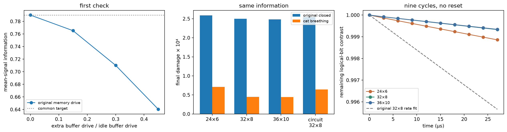
</p>

*figure 23. the earlier cat-breathing result was strong in the ideal model, but
the nonlinear stress test told us the frequency correction was needed.*

the strategy improves the readout's damage and recovery tradeoff relative to
other active readouts. the final audit demonstrates accurate long-record
assignment in the model, but fails the idle-preservation test. that part of the
capstone target remains unmet; section 3.5 gives the measurements behind both
conclusions.

### 5.6 standard-track checklist

| prompt request | evidence | result boundary |
| --- | --- | --- |
| 2.1, fit $\Gamma_X$ versus cat size and discuss direct overlap | section 5.1; `bit_flip_rates.csv`; figure 10 | finite-range exponent, with cutoff and spectral checks |
| 2.2, parity decay and slope against $2\kappa_a$ | section 5.1; `phase_flip_rates.csv`; figure 11 | includes the target $\alpha=2.1$ |
| 2.3, both buffer signals, contrast, and settling | section 5.2; figure 12 | metastable plateau and explicit 2% tolerance |
| 2.4(a), drive implementation and surviving circuit terms | section 5.3; `circuit_matrix_elements.csv` | resonant sine test, with omitted effects stated |
| 2.4(b), contrast versus $\Gamma_X$ as drive increases | section 5.4; `dc_readout_tradeoff.csv` | stationary DC sweep at $\alpha=1.2$ |
| 2.4(c–d), propose, simulate, and explain improved readout | sections 3 and 5.5; control tables; final audit | improved damage tradeoff and accurate long-record readout; idle-preservation test fails |

<a id="decision-schema"></a>

## 6. decision schema: how we chose the final method

this is intentionally written like a tiny database schema because every method
had to earn its way into the final pulse. it is a decision map, not code that has
to be executed.

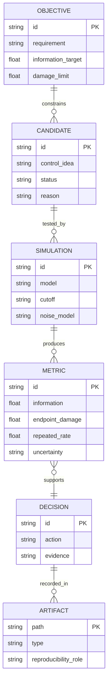

| decision id | question | candidates tested | decision | evidence |
| --- | --- | --- | --- | --- |
| `D01` | can the effective model stand in for the buffer? | effective vs full two-mode | use the full model for claims about transients and readout | `cutoff_convergence.csv`, notebook intro cells |
| `D02` | does the readout need the whole waveform? | boxcar, drive-only, sign-following, matched filter | use the matched filter | `method_receiver_comparison.csv` |
| `D03` | can endpoint closure protect the cat? | flat, resonant, closed, robust closed | keep nominal closed pulse; report robust as a non-winner | `method_control_comparison.csv`, `fails.md` |
| `D04` | can a temporary cat expansion help? | flat vs breathing at matched information | keep breathing as the first creative control | `pump_breathing_*` |
| `D05` | does breathing survive nonlinearities? | ideal and Kerr/cross-Kerr/dephasing stress | do not overclaim the ideal advantage | `pump_breathing_nonlinear_comparison.csv` |
| `D06` | what is missing under cross-Kerr? | breathing, detuning, joint pulse | keep the joint pulse after ablation | `pump_detuning_chi0p30_ablation_32_8.csv` |
| `D07` | does it help more than one cycle? | original vs joint, active minus idle at `chi/2pi = 0.15 MHz` | report the `89.0%` extra-rate reduction | `pump_detuning_nonlinear_cycles_32_8.csv` |
| `D08` | can the effective detuning be reproduced by microwave phases? | chirped tones vs transformed Hamiltonian and receiver | the two descriptions agree within the stated model | `pump_detuning_phase_audit.json` |

the design rule that fell out of this table is simple:

```sql
-- illustrative decision query; each flag refers to its stated experiment
SELECT candidate
FROM controls
WHERE endpoint_information_target_met = TRUE
  AND endpoint_damage_below_matched_flat = TRUE
  AND separate_cycle_test_improved = TRUE
  AND cutoff_checks_passed = TRUE
  AND phase_recipe_checked = TRUE;
```

this summarizes why we selected the joint pulse. the endpoint and cycle flags
refer to their separately stated cross-Kerr settings; it does not rank methods
that we never tested in both experiments. the schema keeps the settings attached
to the result. otherwise we would be doing a very suspicious `JOIN`.

## 7. what failed, and why it matters

the failure log is [`fails.md`](fails.md). we kept it because a good control
story needs a graveyard, not just a trophy shelf.

the discarded ideas include:

- a short pulse with passive listening: too little information under the shared
  amplitude cap;
- a very short flat pulse: infeasible at the target information;
- a longer flat pulse: more leakage at the common endpoint;
- a robust closed pulse: better linearized exchange-frequency sensitivity but
  worse full quantum damage;
- whole-record and drive-only boxcars: they average away the changing-sign
  information;
- a geometric recovery lobe: no equal-information improvement;
- a counterdiabatic derivative correction: every nonzero tested strength made
  logical damage worse;
- random endpoint-preserving perturbations: returning the linearized mean motion
  is not enough to return the nonlinear state;
- a linear damage-aware proxy: looked attractive in the simplified model, lost in
  the full Lindblad score;
- an imaginary buffer-drive quadrature: changed information but did not beat the
  real drive ramp.

the phase-locking audit also found no sampled instability in the tested ideal
two-mode range. that is a useful negative result, not a claim of a new phase
transition. sometimes the most expensive result is “nope, that was not the
mechanism.” the simulator has opinions.

## 8. limitations and claim boundary

we think the result is interesting precisely because the boundary is explicit:

- the master equation is a rotating-wave, two-mode model;
- the final proposal includes a nonlinear stress model with buffer Kerr,
  cross-Kerr, and memory dephasing, but it is not a hardware simulation;
- the receiver uses idealized homodyne records and saved stochastic noise, not a
  calibrated amplifier chain;
- the paired noisy-record improvement from `182` to `162` errors has a 95%
  interval of approximately `[-5.4, +1.5]` percentage points for the new-minus-
  original error fraction, so it is not a resolved receiver win;
- the final nonlinear joint pulse has `14/1024` errors at `21 us`, while flat
  has `9/1024`; it passes our absolute accuracy target without establishing
  improved accuracy over flat. at `3 us`, its error remains about `20%`;
- repeated readout improvement is measured relative to the original active
  readout after subtracting idle control. it does not mean the readout is free;
- the final active / matched-idle contrast-rate ratio is about `1.67`. the
  preservation test fails even after the numerical sensitivity checks;
- cutoff convergence is checked for the reported observables and tails, but no
  finite calculation proves an infinite-dimensional oscillator result;
- the chirp implementation assumes synchronized pump, buffer-drive, and receiver
  phases with calibrated bandwidth; those device responses remain to be checked;
- the control has a calibration boundary. changing the detuning factor too far
  can destroy the information target, so “just compensate more” is not a valid
  prescription.

our supported claim is an improved information-versus-damage tradeoff in the
specified numerical models, with a derived microwave phase prescription.
the final audit adds accurate ideal-detector assignment over `21 us`; it does
not add an accuracy advantage over flat readout or preservation of idle
protection. hardware measurement fidelity remains untested.

## 9. how to reproduce it

### install

```sh
python3 -m venv .venv
.venv/bin/python -m pip install -r requirements.txt
```

then select the project's `.venv` Python interpreter in Jupyter or VS Code and
open [`cat_qubits.ipynb`](cat_qubits.ipynb). run the foundational cells in order
to recompute the introductory tasks, rates, and original readout comparisons.
the notebook uses double precision for the slow rates and records time in
microseconds.

the authoring file [`cat_qubits.py`](cat_qubits.py) and
[`build_notebook.py`](build_notebook.py) support notebook construction and tests;
the executed notebook is the submission artifact. saved CSV/JSON/NPZ files in
[`artifacts/`](artifacts/) make the expensive comparisons inspectable and let the
later analysis sections reload verified results after a kernel restart.

### quick restart path

after restarting the kernel, start at `additions after reviewing the first
results` with `audit_load_saved = True` to inspect the saved addendum. the final
cross-Kerr section also loads its tables directly, and its last phase-audit cell
runs independently.

`audit_load_saved = False` restores the addendum's model and computation path.
`detuning_recompute = True`, after the earlier model setup, reruns the final
strong-cross-Kerr endpoint comparison. it does not regenerate every saved
exploratory table or the separate repeated-cycle data. those are included as
saved results with settings and scope stated above.

the final four cells run independently of that earlier setup. leave
`final_validation_recompute = False` to inspect all audit tables; switch it to
`True` to regenerate density-matrix fits and stochastic receiver samples with
setting-keyed checkpoints. the plan and solver-settings JSON files in
`artifacts/` are required inputs. this path includes both inputs and the final
nonlinear repeated-cycle experiment.

### clean environment check

we installed the pinned requirements into a new virtual environment and ran
the notebook in a fresh kernel and an isolated working directory. this checks
execution with the supplied artifacts; expensive exploratory sections that
default to saved results still load those results. it is not a claim that every
historical control search is repeated on every Run All.

the [machine-readable run record](artifacts/clean_environment_validation.json)
records the interpreter, package versions, execution status, and source hashes
for each executed code cell. all `105` cells (`55` code cells) completed without
an execution error. the corresponding
[executed notebook](artifacts/clean_environment_validation.ipynb) preserves the
outputs, which have also been copied into the submission notebook after an
exact source comparison. a separate [data-integrity check](artifacts/final_validation_data_checks.json)
recounts all six saved score samples, verifies both input counts and plan
hashes, and checks the reported Wilson intervals against SciPy's implementation.
to repeat the notebook check using a newly installed environment:

```sh
.venv/bin/python -m pip check
.venv/bin/python scripts/verify_clean_notebook.py
```

### files worth opening

| file | why it exists |
| --- | --- |
| [`cat_qubits.ipynb`](cat_qubits.ipynb) | full derivation, computation, plots, and report-facing outputs |
| [`artifacts/final_validation_summary.json`](artifacts/final_validation_summary.json) | separate final accuracy, convergence, and preservation decisions |
| [`artifacts/25_final_claim_audit.png`](artifacts/25_final_claim_audit.png) | final assignment error and failed preservation test |
| [`artifacts/24_cross_kerr_aware_readout.png`](artifacts/24_cross_kerr_aware_readout.png) | final capstone figure |
| [`artifacts/pump_detuning_findings.md`](artifacts/pump_detuning_findings.md) | one-paragraph final numerical finding |
| [`artifacts/pump_detuning_chi0p30_recalibrated_32_8.csv`](artifacts/pump_detuning_chi0p30_recalibrated_32_8.csv) | strong-`chi` original vs joint pulse |
| [`artifacts/pump_detuning_chi0p30_ablation_32_8.csv`](artifacts/pump_detuning_chi0p30_ablation_32_8.csv) | breathing-only and detuning-only ablation |
| [`artifacts/pump_detuning_nonlinear_cycles_32_8.csv`](artifacts/pump_detuning_nonlinear_cycles_32_8.csv) | repeated-cycle rates |
| [`artifacts/pump_detuning_cycle_settings.json`](artifacts/pump_detuning_cycle_settings.json) | cross-Kerr value, pulse settings, and fit window of the separate cycle test |
| [`artifacts/pump_detuning_phase_audit.json`](artifacts/pump_detuning_phase_audit.json) | numerical check of the Hamiltonian, baths, and receiver under the chirp |
| [`artifacts/cutoff_convergence.csv`](artifacts/cutoff_convergence.csv) | memory and buffer truncation study |
| [`artifacts/method_receiver_comparison.csv`](artifacts/method_receiver_comparison.csv) | fixed receiver comparison |
| [`fails.md`](fails.md) | the ideas that lost, and what each loss taught us |

## 10. how we got from the first idea to the final one

the first route was the effective one-mode model. it was useful for learning what
two-photon stabilization is supposed to do, but it could not answer the readout
question because the whole readout signal lives in the buffer transient. once we
ran the full model, the memory overshot and the buffer briefly held nearly two
photons. that was our first clue that the transient was not just numerical mess.

then we tried to make the readout behave politely. flat pulses were easy to
understand, resonant pulses made the signal larger, and closed pulses tried to
return the state near the starting point. the matched filter helped a lot, but
the state was still paying for being measured. the boxcar receiver was especially
bad for the closed waveform because it averaged positive and negative pieces of
the ringdown together. the buffer was basically saying, “you asked me to ring and
then ignored the ring.”

the next idea was the cat-breathing pulse: briefly increase the buffer
stabilization drive so the two logical wells separate while the buffer listens.
its endpoint advantage was `82.2%` in the ideal `36 x 10` comparison, but
`12.7%` in the `32 x 8` nonlinear test at `chi/2pi = 0.15 MHz`.
that smaller gain gave us a useful question to investigate.

the cross-Kerr shift suggested tracking the buffer's phase while the cat
expanded. we added the prescribed detuning, then derived the opposing pump and
buffer-drive chirps that reproduce it. keeping the homodyne reference in step
turns out to be essential to measuring the quadrature used by our analysis.

### why this route stayed

we kept the joint pulse because it passed the checks that mattered together:

- it reaches the `0.79` information target in the strong-`chi` stress model,
  where the original capped pulse does not;
- it beats matched flat baselines on endpoint damage;
- its breathing-only and detuning-only ablations are both worse;
- it behaves similarly at `32 x 8` and `36 x 10`;
- a separate calibration at `chi/2pi = 0.15 MHz` lowers the extra repeated-cycle
  readout rate by about `89.0%`;
- its effective detuning has an explicit implementation through synchronized
  pump, buffer-drive, and homodyne phases.

the joint pulse has the best endpoint score among our listed strong-cross-Kerr
candidates and a useful result in the separate cycle test. the final receiver
audit now shows low error after seven cycles, with no established advantage
over flat readout. its failed idle-protection test means the next design should
target total active decay directly. another favorable endpoint plot would not
answer that question. calibrated hardware response is still outside this model.

the project started with “can the buffer's ringing help?” our simulations point
to a useful way of doing it: shape the temporary cat expansion and keep the
measurement phase aligned with the buffer. the cat can meow; the receiver still
has to listen in the right key. 🐈
